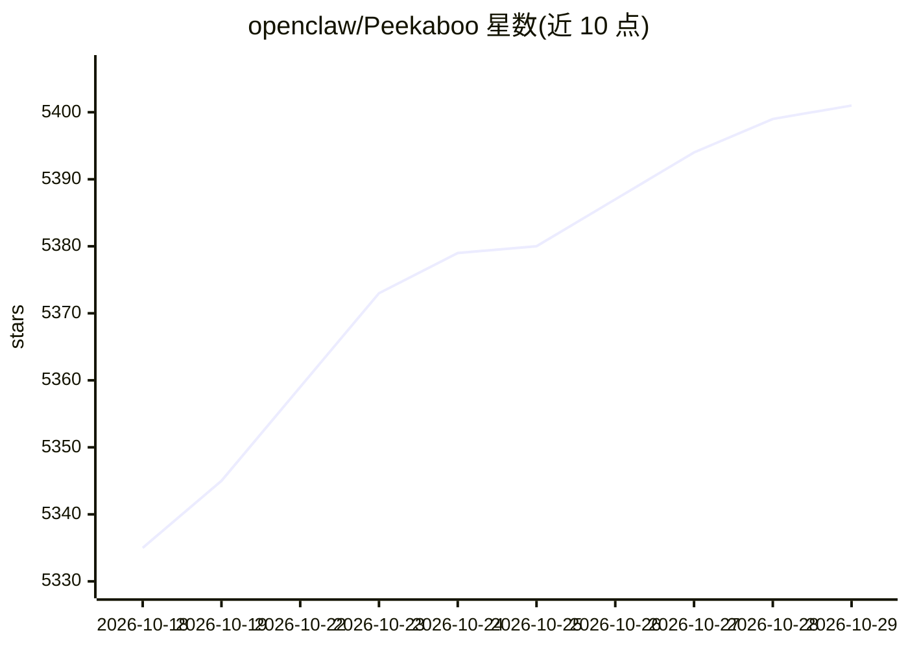

# openclaw/Peekaboo

⭐ 5,401 · Swift · MIT · 推送 2026-10-27 · [GitHub](https://github.com/openclaw/Peekaboo) · [官网](http://www.peekaboo.boo) · 个人维护

**macOS 屏幕截图与 UI 自动化 CLI，可供 AI agent 调用**

面向 macOS 15+ 的命令行工具与菜单栏应用，提供屏幕截图、Accessibility UI 结构化检查、原生 UI 自动化（点击/输入/按键/菜单等），并可打包为 MCP server 供 Codex、Claude Code、Cursor 等 MCP 客户端调用。内置 agent 命令可将观察与操作工具组合为自然语言多步任务，需配置模型 provider（支持托管、兼容与本地后端）。通过 Homebrew、npm 或签名 DMG 安装。

## 筛选速览

| 维度 | 判定 | 备注 |
|---|---|---|
| AI 角色 | `ai-ecosystem` | LLM/agent 周边工具 |
| 许可风险 | `permissive` | MIT |
| 部署形态 | `library` | 以包/库形式分发 |
| 模型依赖 | — | README 未给出锁定关系 |
| 硬件要求 | — | 无带数字的原话,不猜 |
| 安装摩擦 | `low` | 无编译、无系统依赖或容器化 |
| 成熟度 | — | 结构信号不足 |

## 能力要点

- 屏幕截图与带元素 ID 的结构化 UI 检查
- click/type/press/menu 等原生 UI 自动化命令
- 可选 MCP server，暴露工具给 MCP 客户端
- 内置自然语言 agent 执行多步任务，支持多种模型后端

## 适用场景

- 让 AI agent 观察屏幕并操作 macOS 应用
- 通过 CLI 编写应用自动化脚本
- 为 MCP 客户端接入本机 UI 操作能力

## 场景标签

`GUI 自动化` · 领域:效率与自动化

## 证据(README 行号)

> L5: Peekaboo is a macOS CLI and menu-bar app for screen capture, accessibility inspection, and native UI automation. Use
> L85: Agent runs need a configured model provider. See agent setup for providers and sessions, or MCP setup to expose Pee

## 星数曲线

2026-10-18 5,335 → 2026-10-29 5,401（+66）

---
*卡片 v1 · prompt 1.4 · 生成 2026-10-20 · 置信度 high · 依据 README sha `ebb37c91235c` · [字段定义](../../DATASET.md)*
