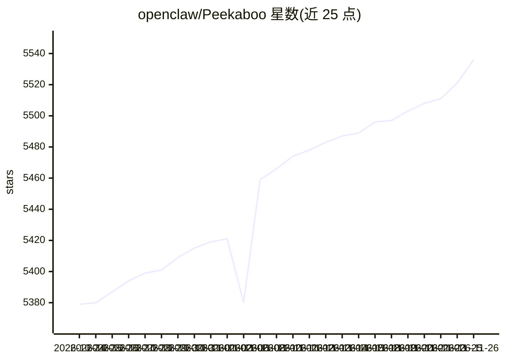

# openclaw/Peekaboo

⭐ 5,536 · Swift · MIT · 推送 2026-11-21 · [GitHub](https://github.com/openclaw/Peekaboo) · [官网](http://www.peekaboo.boo) · 个人维护

**给 AI agent 提供屏幕截图与 UI 自动化能力的 macOS CLI**

macOS 命令行与菜单栏应用，提供屏幕捕获、辅助功能检查与原生 UI 自动化。核心循环是观察屏幕（结构化 UI 元素 ID）、选择元素、执行点击/输入等操作，支持窗口级精确定位与后台输入。内置 agent 可将观察与操作工具组合为自然语言多步骤任务（需配置模型 provider）；同一工具集可通过 MCP server 暴露给 Codex、Claude Code、Cursor 等客户端。发布版要求 macOS 15+，CLI 经 Homebrew 或 npm 分发，另有签名 DMG 应用。

## 筛选速览

| 维度 | 判定 | 备注 |
|---|---|---|
| AI 角色 | `ai-enhanced` | 去掉 AI 部分产品仍成立 |
| 许可风险 | `permissive` | MIT |
| 部署形态 | `library` | 以包/库形式分发 |
| 模型依赖 | — | README 未给出锁定关系 |
| 硬件要求 | — | 无带数字的原话,不猜 |
| 安装摩擦 | `low` | 无编译、无系统依赖或容器化 |
| 成熟度 | — | 结构信号不足 |

## 能力要点

- 结构化 UI 映射：对运行中的应用输出带不透明元素 ID 的界面快照
- 内置自然语言 agent，将观察与操作工具组合为多步骤任务
- 以 MCP server 形式向 Codex、Claude Code、Cursor 等客户端暴露同一工具集
- 语义输入支持后台投递，目标应用无需置于前台

## 适用场景

- 让 AI agent 读取并操作 macOS 应用的界面元素
- 编写脚本自动完成窗口管理、点击、输入等桌面操作
- 通过 MCP 客户端连接本工具执行浏览器外的系统级自动化

## 场景标签

`GUI 自动化` · 领域:效率与自动化

## 证据(README 行号)

> L5: Peekaboo is a macOS CLI and menu-bar app for screen capture, accessibility inspection, and native UI automation. Use
> L85: Agent runs need a configured model provider. See agent setup for providers and sessions, or MCP setup to expose Pee
> L101: Peekaboo stores provider credentials and settings under `~/.peekaboo`. Use `peekaboo config` to inspect or change 

## 星数曲线

2026-10-24 5,379 → 2026-11-26 5,536（+157）

---
*卡片 v1 · prompt 1.4 · 生成 2026-11-22 · 置信度 high · 依据 README sha `a7169bb3d023` · [字段定义](../../DATASET.md)*
