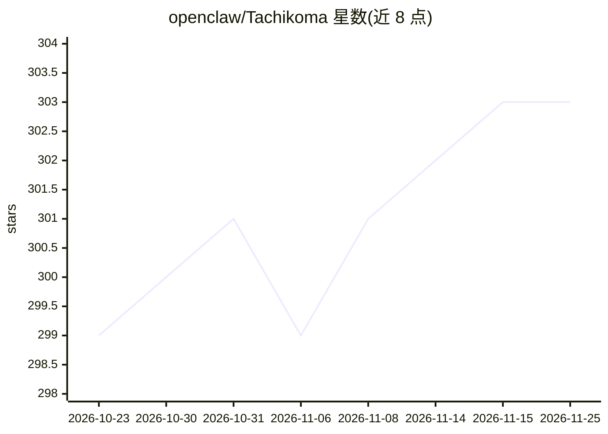

# openclaw/Tachikoma

⭐ 303 · Swift · MIT · 推送 2026-11-21 · [GitHub](https://github.com/openclaw/Tachikoma) · [官网](http://tachikoma.build) · 组织维护

**Swift 开发者的多模型 AI 统一 SDK**

Tachikoma 是一个 Swift 包，为文本生成与流式输出、视觉与工具调用、实时语音与 agent 工作流提供单一的类型安全、并发安全接口，覆盖托管与本地 AI 提供商。内置目录含 OpenAI、Anthropic、Google Gemini、xAI、MiniMax、Kimi、Mistral、Groq、Ollama、LM Studio，并支持自定义 OpenAI/Anthropic 兼容端点。按模块拆分可选产品（Agent、Audio、MCP），需 Swift 6.2，通过 Swift Package Manager 安装。

## 筛选速览

| 维度 | 判定 | 备注 |
|---|---|---|
| AI 角色 | `ai-ecosystem` | LLM/agent 周边工具 |
| 许可风险 | `permissive` | MIT |
| 部署形态 | `None` |  |
| 模型依赖 | local-ok | 支持本地模型 |
| 硬件要求 | — | 无带数字的原话,不猜 |
| 安装摩擦 | `low` | 无编译、无系统依赖或容器化 |
| 成熟度 | — | 结构信号不足 |

## 能力要点

- 统一的 typed、并发安全 Swift 接口调用多家 AI 提供商
- 支持流式输出、视觉、类型化工具调用（maxSteps 反馈循环）
- 可选模块：Agent 会话、语音转写/TTS/实时音频、MCP 集成
- 支持 Ollama、LM Studio 本地模型及自定义兼容端点

## 适用场景

- 在 Swift/iOS/macOS 应用中接入多家大模型而无需逐家写客户端
- 构建带工具调用的 agent 工作流
- 在 Apple 平台应用中实现实时语音转写与 TTS
- 通过 Ollama/LM Studio 在本地运行模型

## 场景标签

`模型网关` · 领域:Agent 开发

## 证据(README 行号)

> L13: Tachikoma is a Swift package for generating and streaming text, using vision and tools, and building realtime voice
> L65: The built-in catalog covers OpenAI, Anthropic, Google Gemini, xAI, MiniMax, Kimi, Mistral, Groq, Ollama, and LM Stu

## 星数曲线

2026-10-23 299 → 2026-11-25 303（+4）

---
*卡片 v1 · prompt 1.4 · 生成 2026-11-25 · 置信度 high · 依据 README sha `a34aa207db0e` · [字段定义](../../DATASET.md)*
