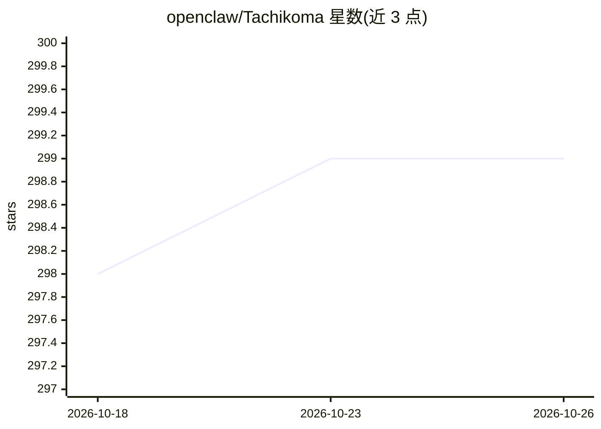

# openclaw/Tachikoma

⭐ 299 · Swift · MIT · 推送 2026-10-19 · [GitHub](https://github.com/openclaw/Tachikoma) · [官网](http://tachikoma.build) · 组织维护

**Swift 统一 AI SDK：一套类型安全接口接入多家模型服务商**

面向 Swift 应用的 AI 接入 SDK：以单一类型化、并发安全的接口封装文本生成、流式输出、视觉、工具调用、语音转录/TTS/实时音频与 Agent 工作流，替代各家服务商的专属客户端。内置目录覆盖 OpenAI、Anthropic、Gemini、xAI、MiniMax、Kimi、Mistral、Groq、Ollama、LM Studio 等服务商，并支持自定义 OpenAI/Anthropic 兼容端点。凭据从环境变量或 TKAuthManager 读取。要求 Swift 6.2，声明部署目标为 macOS 14/iOS 17/tvOS 17/watchOS 10/visionOS 1，Linux 由 CI 覆盖。包拆分为核心、Agent、Audio、MCP 四个可选模块。

## 筛选速览

| 维度 | 判定 | 备注 |
|---|---|---|
| AI 角色 | `ai-ecosystem` | LLM/agent 周边工具 |
| 许可风险 | `permissive` | MIT |
| 部署形态 | `None` |  |
| 模型依赖 | local-ok | 支持本地模型 |
| 硬件要求 | — | 无带数字的原话,不猜 |
| 安装摩擦 | `low` | 无编译、无系统依赖或容器化 |
| 成熟度 | — | 结构信号不足 |

## 能力要点

- 单一类型化接口覆盖文本生成、流式输出、视觉与工具调用
- 内置 10 家服务商目录，另支持 OpenAI/Anthropic 兼容自定义端点
- 可选模块：Agent 工作流、音频（转录/TTS/实时）、MCP 集成
- 凭据从环境变量或 TKAuthManager 存储档案解析

## 适用场景

- 在 Swift 应用中用一套 API 切换多家 AI 服务商
- 构建带工具调用与多步执行的 Agent 工作流
- 接入本地模型（Ollama/LM Studio）做生成与转录

## 场景标签

`模型网关` `Agent 框架` · 领域:Agent 开发

## 证据(README 行号)

> L13: Tachikoma is a Swift package for generating and streaming text, using vision and tools, and building realtime voice
> L65: The built-in catalog covers OpenAI, Anthropic, Google Gemini, xAI, MiniMax, Kimi, Mistral, Groq, Ollama, and LM Stu

## 星数曲线

2026-10-18 298 → 2026-10-26 299（+1）

---
*卡片 v1 · prompt 1.4 · 生成 2026-10-21 · 置信度 high · 依据 README sha `f246aa32e50e` · [字段定义](../../DATASET.md)*
