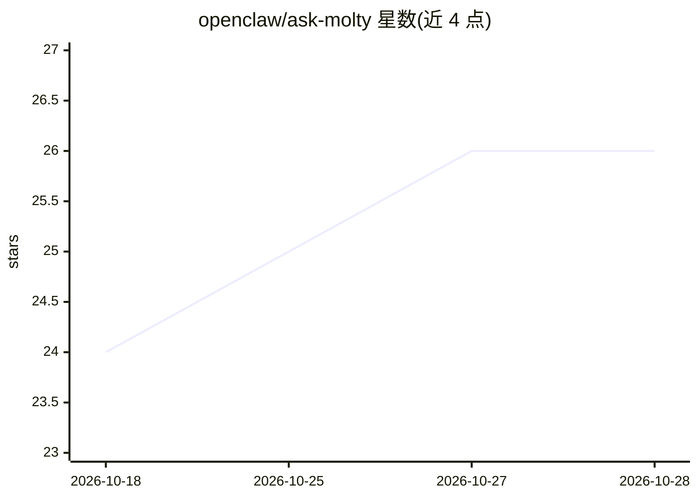

# openclaw/ask-molty

⭐ 26 · TypeScript · MIT · 推送 2026-10-26 · [GitHub](https://github.com/openclaw/ask-molty) · [官网](https://docs.openclaw.ai) · 组织维护

**OpenClaw 文档问答 agent：docs-chat 背后的 Worker 与工具循环**

支撑 docs-chat.openclaw.ai 的文档问答 agent 代码库：包含 Cloudflare Worker、系统提示词与工具循环，以及将文档、源码、GitHub issues/PRs 导出为只读静态工作区的构建脚本。运行时由 Worker 做确定性候选检索，把最匹配的文件挂载到内存工作区，模型可调用 search/read/list_workspace 与一个模拟只读的 run_shell，四轮工具上限，完成后的答案直接返回。部署依赖 OPENAI_API_KEY 与 OpenClaw ID 登录流程。

## 筛选速览

| 维度 | 判定 | 备注 |
|---|---|---|
| AI 角色 | `ai-native` | 本体是模型或模型工具 |
| 许可风险 | `permissive` | MIT |
| 部署形态 | `library` | 以包/库形式分发 |
| 模型依赖 | — | README 未给出锁定关系 |
| 硬件要求 | — | 无带数字的原话,不猜 |
| 安装摩擦 | `low` | 无编译、无系统依赖或容器化 |
| 成熟度 | — | 结构信号不足 |

## 能力要点

- 导出脚本生成文档/源码/GitHub 讨论的扁平只读工作区（JSONL 索引）
- 内存工作区工具循环：search/read/list_workspace 与只读模拟 run_shell
- 四轮工具上限；完成的工具循环答案不再发起第二次模型请求
- 通过 OpenClaw ID (OIDC) 登录，检索读取 openclaw-docs R2 桶

## 适用场景

- 为 OpenClaw 文档站提供带引用的对话式问答服务
- 将文档、源码与 GitHub 讨论统一纳入 agent 检索工作区
- 在 Cloudflare Workers 上部署文档 chat 服务

## 场景标签

`文档问答` · 领域:知识与检索

## 证据(README 行号)

> L5: Ask Molty is the OpenClaw documentation agent.
> L27: The Worker does deterministic candidate retrieval, mounts the best docs/source/GitHub files into a small in-memory 

## 星数曲线

2026-10-18 24 → 2026-10-28 26（+2）

---
*卡片 v1 · prompt 1.4 · 生成 2026-10-27 · 置信度 high · 依据 README sha `841b526ca0f5` · [字段定义](../../DATASET.md)*
