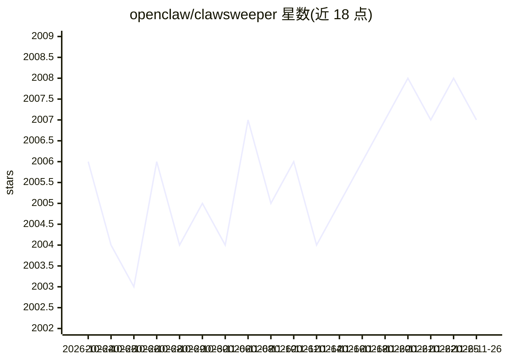

# openclaw/clawsweeper

⭐ 2,007 · TypeScript · MIT · 推送 2026-11-25 · [GitHub](https://github.com/openclaw/clawsweeper) · [官网](https://clawsweeper.bot) · 组织维护

**OpenClaw 仓库的自动审查机器人：扫描 issue/PR 并提出关闭建议**

面向 OpenClaw 系列仓库的保守型 review bot：定时与事件驱动地扫描开放的 issue 和 PR，生成含决策、证据、建议评论与快照哈希的审查记录，经确定性安全门后应用高置信度关闭提案。通过 marker 标记的单一公开评论原位同步、维护者命令（review/re-review/explain/stop）、GitHub 标签投影与 Cloudflare Worker/Durable Object/R2 状态存储运行。仅当条目命中明确定义的关闭类别（已实现、不可复现、重复、过期等）时才提案关闭，其余保持开放。

## 筛选速览

| 维度 | 判定 | 备注 |
|---|---|---|
| AI 角色 | `ai-native` | 本体是模型或模型工具 |
| 许可风险 | `permissive` | MIT |
| 部署形态 | `library` | 以包/库形式分发 |
| 模型依赖 | — | README 未给出锁定关系 |
| 硬件要求 | — | 无带数字的原话,不猜 |
| 安装摩擦 | `medium` | 含编译或系统依赖之一 |
| 成熟度 | — | 结构信号不足 |

## 能力要点

- 定时扫描全部开放 issue/PR 并生成含证据的审查记录
- 确定性安全门限制关闭提案，仅命中明确类别时才关闭
- 维护者评论命令：@clawsweeper review/re-review/explain/stop
- 审查结论投影为只读的建议性 GitHub 标签与 triage 面板

## 适用场景

- 自动审查 OpenClaw 仓库积压的 issue 与 PR
- 让维护者按建议性标签过滤当前可复现/待修复的条目
- 对外部低信号或长期停滞的 PR 做保守的关闭清理

## 场景标签

`代码审查` · 领域:编码与开发

## 证据(README 行号)

> L5: ClawSweeper is the conservative review bot for OpenClaw repositories. It keeps
> L27: one-item reviews. Each review writes
> L226: - review lane: scheduled and event-driven issue/PR reviews, durable reports, and

## 星数曲线

2026-10-24 2,006 → 2026-11-26 2,007（+1）

---
*卡片 v1 · prompt 1.4 · 生成 2026-11-23 · 置信度 high · 依据 README sha `a6624417c4b3` · [字段定义](../../DATASET.md)*
