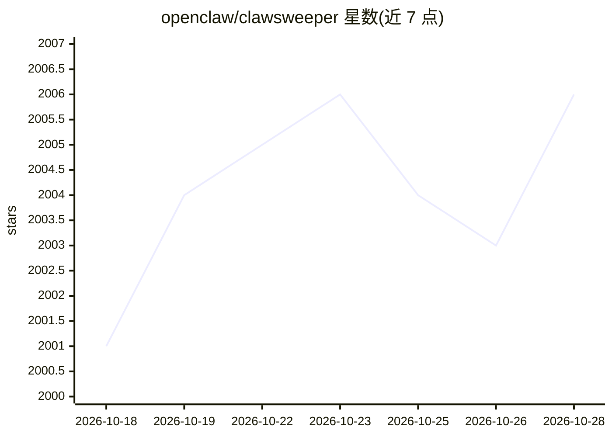

# openclaw/clawsweeper

⭐ 2,006 · TypeScript · MIT · 推送 2026-10-27 · [GitHub](https://github.com/openclaw/clawsweeper) · [官网](https://clawsweeper.bot) · 组织维护

**面向 OpenClaw 仓库的议题/PR 保守审阅机器人**

定期扫描开源仓库的开放 issues 与 PR，生成含决策、证据与建议评论的审阅记录，仅在通过确定性安全闸门（如已在 main 实现、重复、长期无响应等情形）时提出关闭建议。审阅上下文与决策包由 Codex 生成，代码侧负责校验、落盘（Durable Object + R2）与受控 apply。运行于 GitHub Actions 与 Cloudflare Worker，提供仪表盘与 @clawsweeper 评论命令。

## 筛选速览

| 维度 | 判定 | 备注 |
|---|---|---|
| AI 角色 | `ai-native` | 本体是模型或模型工具 |
| 许可风险 | `permissive` | MIT |
| 部署形态 | `library` | 以包/库形式分发 |
| 模型依赖 | — | README 未给出锁定关系 |
| 硬件要求 | — | 无带数字的原话,不猜 |
| 安装摩擦 | `medium` | 含编译或系统依赖之一 |
| 成熟度 | — | 结构信号不足 |

## 能力要点

- 定时与事件驱动的 issue/PR 审阅，生成持久化记录与单一同步评论
- 关闭建议须经确定性安全闸门（实现/复现/重复/停滞等 11 类条件）
- Codex 生成结构化决策包，代码侧校验意图后持久化
- 提供 /triage、/pr-proof-triage 等只读维护者视图

## 适用场景

- 我维护的仓库积压大量 issue/PR，希望有机器人定期审阅并给出关闭建议
- 通过 @clawsweeper 命令请求单项只读审阅或解释结果
- 在仪表盘查看队列、审阅与发布状态

## 场景标签

`代码审查` · 领域:编码与开发

## 证据(README 行号)

> L5: ClawSweeper is the conservative review bot for OpenClaw repositories. It keeps
> L84: maintainer ruling. Codex supplies the exact question, rationale, options,

## 星数曲线

2026-10-18 2,001 → 2026-10-28 2,006（+5）

---
*卡片 v1 · prompt 1.4 · 生成 2026-10-21 · 置信度 mid · 依据 README sha `affc0e2215fe` · [字段定义](../../DATASET.md)*
