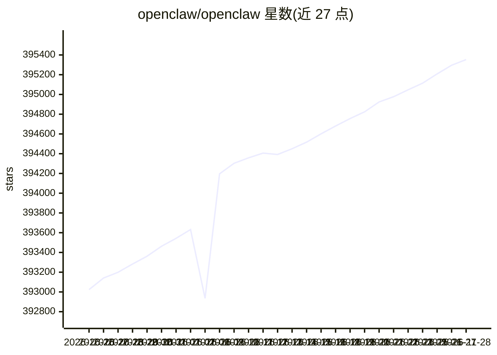

# openclaw/openclaw

⭐ 395,353 · TypeScript · MIT · 推送 2026-11-27 · [GitHub](https://github.com/openclaw/openclaw) · [官网](https://openclaw.ai) · 组织维护

**自托管开源 AI 助手：在自己设备上接入聊天渠道运行**

开源 AI 助手，运行在用户自己的设备上，通过 Gateway 连接 Discord、iMessage、Slack、Teams、Telegram、WhatsApp 等 20+ 聊天渠道，并提供 macOS/iOS/Android/Windows/Linux 原生应用。状态、记忆与凭证存放在用户本地硬件；模型与 agent harness（Claude、Codex、本地模型）以可插拔方式接入。Gateway 为本地控制平面，管理会话、工具、事件与渠道连接，支持个人或多人共享部署。由 OpenClaw Foundation（独立 501(c)(3)）维护，无付费层与托管服务；默认开启每日更新检查，可配置关闭遥测。

## 筛选速览

| 维度 | 判定 | 备注 |
|---|---|---|
| AI 角色 | `ai-native` | 本体是模型或模型工具 |
| 许可风险 | `permissive` | MIT |
| 部署形态 | `library` | 以包/库形式分发 |
| 模型依赖 | — | README 未给出锁定关系 |
| 硬件要求 | — | 无带数字的原话,不猜 |
| 安装摩擦 | `low` | 无编译、无系统依赖或容器化 |
| 成熟度 | — | 结构信号不足 |

## 动量与使用信号

- 维护:`active` — 距上次 push 0.6 天,年发版 100,380 位贡献者
- 涨星:近 1 天 **+138**(自 20261016 起算)
- 安装:npm 包 `openclaw` 月下载 14,961,588
- 平台:WINDOWS / MACOS / LINUX / ANDROID / IOS · 协议:—

## 能力要点

- 接入 20+ 聊天渠道与五平台原生应用
- 本地 Gateway 控制平面，状态/记忆/凭证留在用户硬件
- 模型与 agent harness 以可替换插件接入（含本地模型）
- 支持沙箱、发件人配对等安全机制

## 适用场景

- 在自有设备上运行不依赖托管服务的个人 AI 助手
- 让助手出现在 WhatsApp/Telegram/Discord 等日常聊天工具里
- 一台笔记本个人使用或多用户共享同一个助手实例

## 场景标签

`AI 助手` · 领域:对话与助手

## 证据(README 行号)

> L11: OpenClaw is an open-source AI assistant that runs on your own computer and meets you in the channels you already us
> L65: - The Gateway is the local control plane for sessions, tools, events, and channel connections.
> L70: OpenClaw works with hosted and local model providers. Its tools, skills, and plugins extend what an assistant can d

## 星数曲线

2026-10-26 393,024 → 2026-11-28 395,353（+2,329）

---
*卡片 v1 · prompt 1.4 · 生成 2026-11-28 · 置信度 high · 依据 README sha `709776ee4a4c` · [字段定义](../../DATASET.md)*
