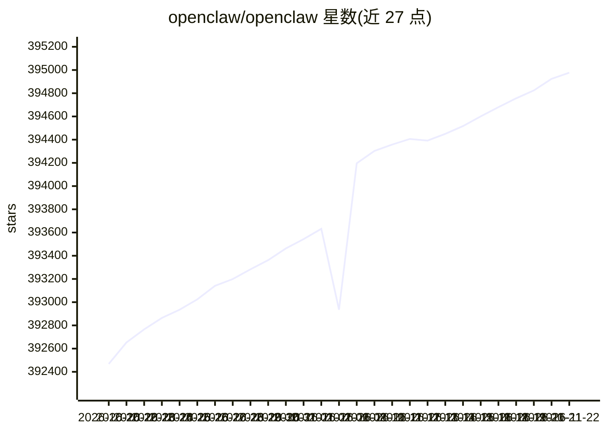

# openclaw/openclaw

⭐ 394,977 · TypeScript · MIT · 推送 2026-11-21 · [GitHub](https://github.com/openclaw/openclaw) · [官网](https://openclaw.ai) · 组织维护

**自托管开源 AI 助手：接入聊天渠道运行在个人设备上**

OpenClaw 是开源 AI 助手，运行在用户自己的设备上，通过 Discord、iMessage、Slack、Telegram、WhatsApp 等 20+ 消息渠道以及 macOS/iOS/Android/Windows/Linux 原生应用交付。架构为本地 Gateway 控制会话、工具、事件与渠道连接；状态、记忆与凭据保存在用户硬件上。模型与 agent harness（Claude、Codex、本地模型）以可替换插件形式接入。由 OpenClaw Foundation（独立 501(c)(3)）维护，无付费层或托管服务；默认仅每日版本检查联网，匿名统计需主动开启。

## 筛选速览

| 维度 | 判定 | 备注 |
|---|---|---|
| AI 角色 | `ai-native` | 本体是模型或模型工具 |
| 许可风险 | `permissive` | MIT |
| 部署形态 | `library` | 以包/库形式分发 |
| 模型依赖 | — | README 未给出锁定关系 |
| 硬件要求 | — | 无带数字的原话,不猜 |
| 安装摩擦 | `low` | 无编译、无系统依赖或容器化 |
| 成熟度 | — | 结构信号不足 |

## 动量与使用信号

- 维护:`active` — 距上次 push 0.6 天,年发版 100,380 位贡献者
- 涨星:近 1 天 **+138**(自 20261016 起算)
- 安装:npm 包 `openclaw` 月下载 14,961,588
- 平台:WINDOWS / MACOS / LINUX / ANDROID / IOS · 协议:—

## 能力要点

- 支持 20+ 消息渠道与五平台原生应用
- 模型与 agent harness 以插件形式可替换（Claude/Codex/本地模型）
- 状态、记忆与凭据保留在用户硬件，本地 Gateway 架构
- 工具运行支持沙箱配置与消息发送者配对审批机制

## 适用场景

- 在个人设备上运行助理并接入既有聊天工具
- 以多渠道方式向家人或团队共享一个助理实例
- 在数据不出本地的约束下使用 AI 助手

## 场景标签

`AI 助手` · 领域:对话与助手

## 证据(README 行号)

> L11: OpenClaw is an open-source AI assistant that runs on your own computer and meets you in the channels you already us
> L63: - The Gateway is the local control plane for sessions, tools, events, and channel connections.

## 星数曲线

2026-10-20 392,468 → 2026-11-22 394,977（+2,509）

---
*卡片 v1 · prompt 1.4 · 生成 2026-11-22 · 置信度 high · 依据 README sha `238059236018` · [字段定义](../../DATASET.md)*
