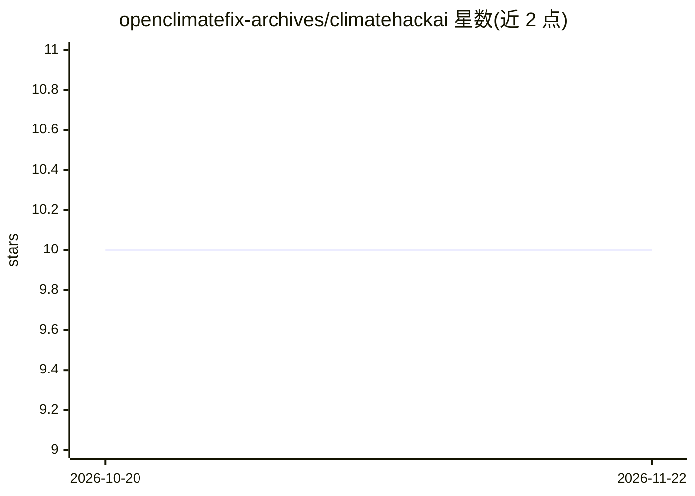

# openclimatefix-archives/climatehackai

⭐ 10 · Python · 推送 2026-01-19 · [GitHub](https://github.com/openclimatefix-archives/climatehackai) · 组织维护

**2022 Climate Hack AI 竞赛模型的统一仓库（基于 Lightning-Hydra 模板）**

汇集 2022 Climate Hack AI 竞赛模型的仓库，整体采用 lightning-hydra-template 结构：以 PyTorch Lightning 为训练框架、Hydra 管理分层配置，内置 MNIST 示例、命令行参数覆盖、超参搜索（Optuna Sweeper）、断点续训、实验追踪（W&B/Tensorboard/MLFlow 等）与统一日志目录结构。README 明确说明该模板定位为快速实验工具，不适用于生产/部署环境；使用需先学习 PyTorch、Lightning 与 Hydra。

## 筛选速览

| 维度 | 判定 | 备注 |
|---|---|---|
| AI 角色 | `ai-ecosystem` | LLM/agent 周边工具 |
| 许可风险 | `none` | — |
| 部署形态 | `self-host` | docker 或自建部署 |
| 模型依赖 | — | README 未给出锁定关系 |
| 硬件要求 | — | 无带数字的原话,不猜 |
| 安装摩擦 | `low` | 无编译、无系统依赖或容器化 |
| 成熟度 | — | 结构信号不足 |

## 能力要点

- Hydra 配置驱动：命令行覆盖参数、组合实验配置、批量 sweep
- PyTorch Lightning 支持 CPU/GPU/多 GPU/TPU 训练与混合精度
- 内置 Optuna 超参搜索与 Ray 集群启动插件路径
- 集成 W&B、Neptune、Comet、MLFlow、Tensorboard 实验追踪

## 适用场景

- 复现竞赛模型或开展小团队深度学习研究项目
- 在计算集群上做超参数搜索实验
- 为新的深度学习项目快速搭建可复现的实验结构

## 场景标签

`MLOps` · 领域:训练与推理

## 证据(README 行号)

> L9: A clean and scalable template to kickstart your deep learning project 🚀⚡🔥
> L18: > Effective usage requires learning of a couple of technologies: PyTorch, PyTorch Lightning and Hydra. Knowledge of

## 星数曲线

2026-10-20 10 → 2026-11-22 10（+0）

---
*卡片 v1 · prompt 1.4 · 生成 2026-11-19 · 置信度 low · 依据 README sha `bf1f786ae079` · [字段定义](../../DATASET.md)*
