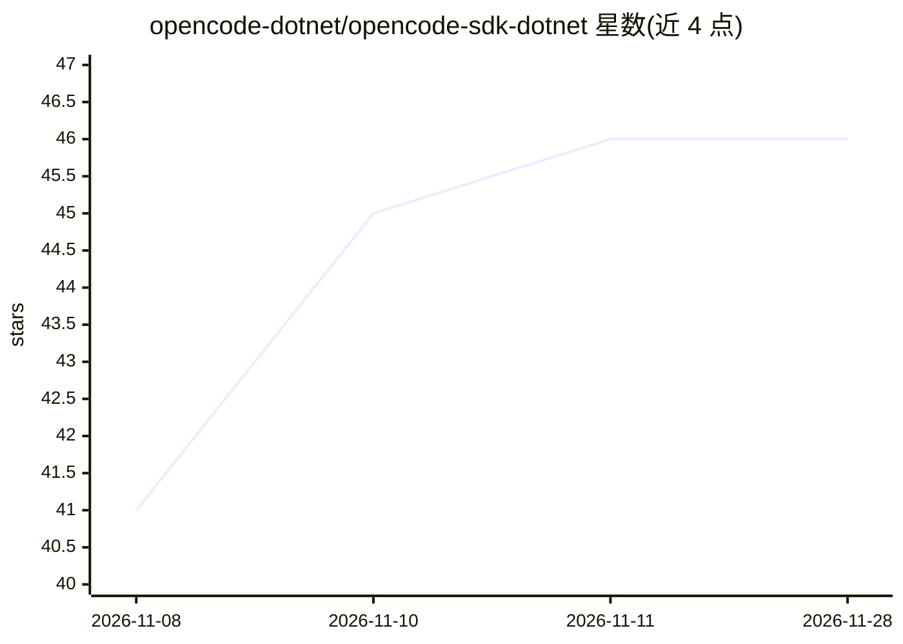

# opencode-dotnet/opencode-sdk-dotnet

⭐ 46 · C# · MIT · 推送 2026-11-24 · [GitHub](https://github.com/opencode-dotnet/opencode-sdk-dotnet) · [官网](https://www.nuget.org/packages/OpenCodeDotNet.Sdk/) · 组织维护

**面向 .NET 开发者的 opencode HTTP API 非官方类型化 SDK**

为 opencode 服务端 2.x HTTP API 生成的强类型 .NET 客户端：每个操作带生成的请求/响应类型与类型化错误模型，覆盖会话、事件流、PTY 终端、文件/VCS、MCP、providers 等 API 区域，三种 WebSocket 连接采用手写传输。支持三种连接模式：SDK 启动私有服务器、连接已有服务器、发现 CLI 后台服务。以 NuGet 包分发，另提供依赖注入扩展包与四个示例应用；目标框架含 .NET 11/10、netstandard2.0 与 .NET Framework 4.7.2+，采用 System.Text.Json 源生成、声明 AOT 兼容。上游协议按快照固定，需搭配 opencode CLI 使用。

## 筛选速览

| 维度 | 判定 | 备注 |
|---|---|---|
| AI 角色 | `ai-ecosystem` | LLM/agent 周边工具 |
| 许可风险 | `permissive` | MIT |
| 部署形态 | `desktop` | 安装包/桌面程序 |
| 模型依赖 | — | README 未给出锁定关系 |
| 硬件要求 | — | 无带数字的原话,不猜 |
| 安装摩擦 | `medium` | 含编译或系统依赖之一 |
| 成熟度 | — | 结构信号不足 |

## 能力要点

- 覆盖固定版本的全部 opencode API，含三类 WebSocket 连接（终端/持久终端/客户端托管 MCP）
- 三种服务器连接模式：SDK 启动私有实例、连接外部服务器、发现 CLI 后台服务
- 类型化错误模型与 NoThrow 模式，支持 net472 与 AOT 兼容
- 提供 DI 扩展包（AddOpenCode）与四个可运行示例（QuickStart/HQ/Worker/AotCli）

## 适用场景

- 在 .NET 应用中驱动 opencode 编码 agent：发送提示并流式接收回复
- 构建管理 opencode 会话、权限审批、终端与 MCP 集成的自定义前端
- 以 Native AOT 或 .NET Framework 宿主集成 opencode 服务

## 场景标签

`编码 Agent` · 领域:编码与开发

## 证据(README 行号)

> L10: A strongly typed .NET client for the opencode server — the
> L11: HTTP API that every opencode front-end (TUI, desktop, web UI, plugins) uses. The SDK speaks the

## 星数曲线

2026-11-08 41 → 2026-11-28 46（+5）

---
*卡片 v1 · prompt 1.4 · 生成 2026-11-18 · 置信度 mid · 依据 README sha `39cad5489145` · [字段定义](../../DATASET.md)*
