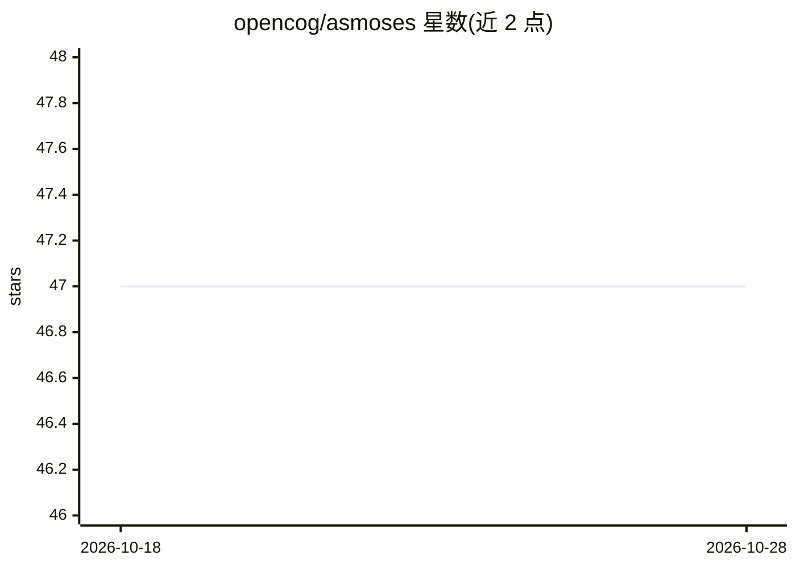

# opencog/asmoses

⭐ 47 · C++ · NOASSERTION · 推送 2025-12-10 · [GitHub](https://github.com/opencog/asmoses) · [官网](https://wiki.opencog.org/w/Meta-Optimizing_Semantic_Evolutionary_Search) · 组织维护

**进化式程序学习工具：从数据中学出可复现数据模式的程序**

MOSES 是基于遗传规划（进化程序学习）的机器学习工具：从输入数据集中学习能大致复现训练数据的短程序，输出为 Atomese 或 Python 形式。核心机制是对程序树选取适应度较高的范例并施加随机变异，迭代寻找更准确的程序。已用于医疗临床数据分析与金融系统，也为 OpenCog 虚拟代理学习行为程序。源自 Moshe Looks 2006 年博士论文。构建需依赖 boost、cmake、guile、cogutil、atomspace、ure 等组件，采用 Apache 2.0 与 AGPL 3 双许可。

## 筛选速览

| 维度 | 判定 | 备注 |
|---|---|---|
| AI 角色 | `ai-native` | 本体是模型或模型工具 |
| 许可风险 | `none` | NOASSERTION |
| 部署形态 | `None` |  |
| 模型依赖 | — | README 未给出锁定关系 |
| 硬件要求 | — | 无带数字的原话,不猜 |
| 安装摩擦 | `medium` | 含编译或系统依赖之一 |
| 成熟度 | — | 结构信号不足 |

## 能力要点

- 遗传规划进化学习短程序，输出 Atomese 或 Python
- 可用于临床数据分析、金融系统等场景
- 支持 MPI 构建计算集群版本（可选）
- 提供 /docs 文档、man 手册与示例目录

## 适用场景

- 从数据集中学习可解释的短程序（程序合成）
- 作为 OpenCog/AtomSpace 生态的学习组件
- 科研上复现 MOSES 进化搜索算法

## 场景标签

 · 领域:机器学习/遗传规划

## 证据(README 行号)

> L7: MOSES is a machine-learning tool; it is an "evolutionary program
> L9: patterns in input datasets. These programs can be output in either
> L11: language, or in python. For a given data input, the programs will

## 星数曲线

2026-10-18 47 → 2026-10-28 47（+0）

---
*卡片 v1 · prompt 1.4 · 生成 2026-10-25 · 置信度 high · 依据 README sha `d9c9862c4114` · [字段定义](../../DATASET.md)*
