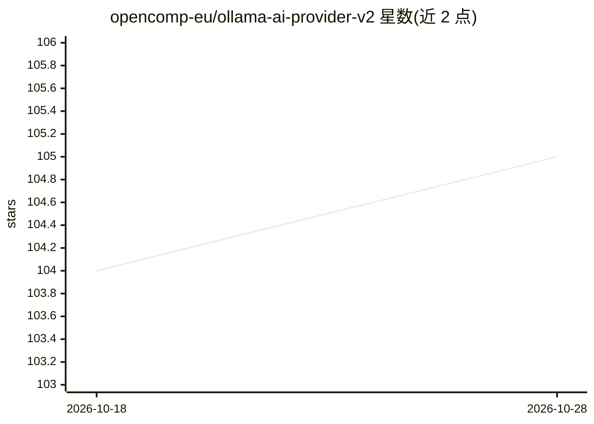

# opencomp-eu/ollama-ai-provider-v2

⭐ 105 · TypeScript · Apache-2.0 · 推送 2026-10-26 · [GitHub](https://github.com/opencomp-eu/ollama-ai-provider-v2) · [官网](https://www.npmjs.com/package/ollama-ai-provider-v2) · 个人维护

**让 Vercel AI SDK 通过本地 Ollama 运行 LLM 的 TypeScript Provider**

为 Vercel AI SDK 实现官方 Ollama API 的社区 Provider 库，供开发者用 generateText/streamText/embed 等接口调用本地或远程 Ollama 实例中的模型。支持工具调用、流式输出、思考/推理模式、嵌入与补全模型，可通过 providerOptions 访问 Ollama 原生参数，createOllama 可连接自定义 Ollama 服务器。核心依赖仅 2 个，兼容 Node.js/浏览器/边缘环境。要求 Ollama 已安装运行、AI SDK v7 与 Node.js 22+；v4 版本放弃对 AI SDK 5/6 的支持。业余时间维护，Apache-2.0 许可。

## 筛选速览

| 维度 | 判定 | 备注 |
|---|---|---|
| AI 角色 | `ai-ecosystem` | LLM/agent 周边工具 |
| 许可风险 | `permissive` | Apache-2.0 |
| 部署形态 | `library` | 以包/库形式分发 |
| 模型依赖 | local-ok | 支持本地模型 |
| 硬件要求 | — | 无带数字的原话,不猜 |
| 安装摩擦 | `low` | 无编译、无系统依赖或容器化 |
| 成熟度 | — | 结构信号不足 |

## 能力要点

- 实现官方 Ollama API，核心依赖仅 2 个，兼容 Node.js/浏览器/边缘环境
- 支持工具调用、流式生成、思考/推理模式、嵌入与补全模型
- createOllama 可连接远程或自定义 Ollama 实例
- 可通过 providerOptions 访问 Ollama 原生参数

## 适用场景

- 在 Vercel AI SDK 项目中调用本地 Ollama 模型做生成与嵌入
- 在浏览器或边缘环境连接自托管 Ollama 服务
- 用 deepseek-r1 等推理模型配合 reasoning 选项做链式思考

## 场景标签

 · 领域:LLM 基础设施/SDK 接入

## 证据(README 行号)

> L3: Use Ollama with the Vercel AI SDK, implementing the official Ollama API. This provider has minimal dependencies and 
> L16: - ✅ **Direct Ollama Integration** - Uses official Ollama API endpoints for maximum compatibility

## 星数曲线

2026-10-18 104 → 2026-10-28 105（+1）

---
*卡片 v1 · prompt 1.4 · 生成 2026-10-23 · 置信度 high · 依据 README sha `ccdab7f835dc` · [字段定义](../../DATASET.md)*
