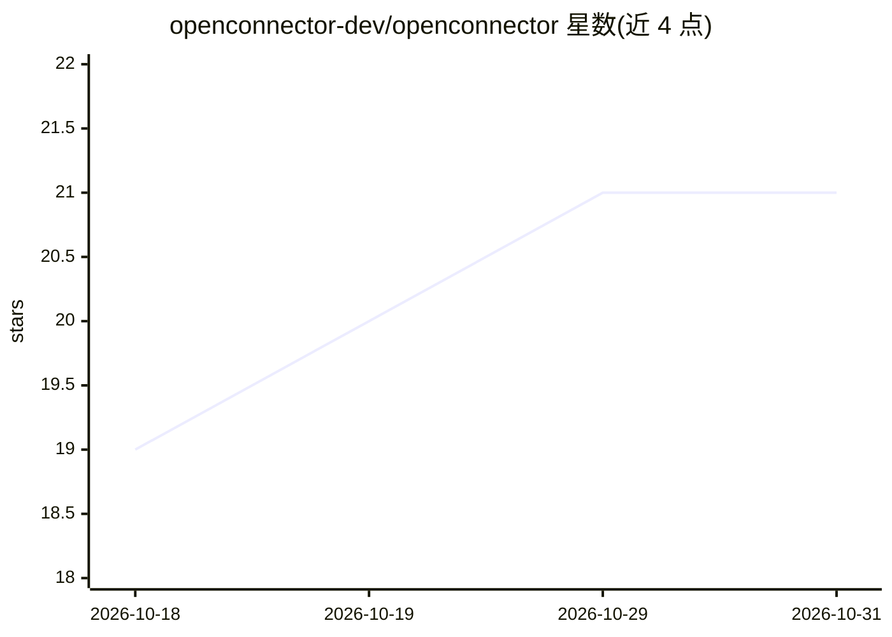

# openconnector-dev/openconnector

⭐ 21 · AGPL-3.0 · 推送 2026-10-13 · [GitHub](https://github.com/openconnector-dev/openconnector) · [官网](https://openconnector.dev) · 组织维护

**面向 AI agent 的自托管连接器平台（源码待发布）**

定位为 agent-first 的自托管连接器平台，用于将外部服务/API 以 agent 可用的方式接入，仓库主题含 MCP、MCP 网关、OAuth、API 集成与 CLI。当前仓库仅含项目说明与 AGPLv3.0 许可声明，源码尚未发布，产品信息指向 openconnector.dev，文档指向 docs.openconnector.dev。README 未提供安装命令、功能细节或运行方式，可验证事实有限。

## 筛选速览

| 维度 | 判定 | 备注 |
|---|---|---|
| AI 角色 | `ai-ecosystem` | LLM/agent 周边工具 |
| 许可风险 | `viral` | AGPL-3.0 |
| 部署形态 | `None` |  |
| 模型依赖 | — | README 未给出锁定关系 |
| 硬件要求 | — | 无带数字的原话,不猜 |
| 安装摩擦 | `low` | 无编译、无系统依赖或容器化 |
| 成熟度 | `idea` | |

## 能力要点

- 定位 agent-first 的自托管连接器平台
- 仓库主题包含 MCP/MCP 网关、OAuth、API 集成、CLI
- 以 AGPLv3.0 许可，源码声明即将公开发布

## 适用场景

- 关注其发布后为 AI agent 接入外部服务
- 通过官网与文档站了解产品信息

## 场景标签

 · 领域:AI Agent 基础设施/集成

## 证据(README 行号)

> L3: Open Connector is an agent-first, self-hostable connector platform for AI agents.
> L5: The project source code is being prepared for public release and will be published here soon.

## 星数曲线

2026-10-18 19 → 2026-10-31 21（+2）

---
*卡片 v1 · prompt 1.4 · 生成 2026-10-28 · 置信度 mid · 依据 README sha `d8c6e3517662` · [字段定义](../../DATASET.md)*
