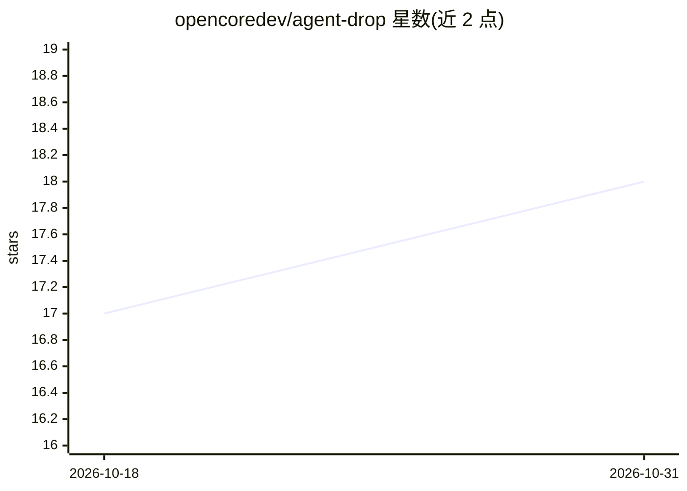

# opencoredev/agent-drop

⭐ 18 · TypeScript · MIT · 推送 2026-10-23 · [GitHub](https://github.com/opencoredev/agent-drop) · [官网](https://www.agent-drop.co/) · 组织维护

**为 AI agent 提供静态站点托管的 MCP/API 服务**

AgentDrop 是一个面向 AI agent 的静态页面托管服务：通过一次 HTTP 调用或 MCP 工具调用，把 Markdown 或 HTML 文档部署为带版本的在线 URL。支持无状态 MCP（OAuth 2.1）、撤销/重做历史、多种可见性级别（public/unlisted/team/private）、图片上传与页面过期策略（匿名 30 天、认领 90 天、图片 7 天）。提供 API 端点与自托管路径（Bun + Convex + Cloudflare R2）。匿名可用，无账号无 API key。

## 筛选速览

| 维度 | 判定 | 备注 |
|---|---|---|
| AI 角色 | `ai-ecosystem` | LLM/agent 周边工具 |
| 许可风险 | `permissive` | MIT |
| 部署形态 | `library` | 以包/库形式分发 |
| 模型依赖 | — | README 未给出锁定关系 |
| 硬件要求 | — | 无带数字的原话,不猜 |
| 安装摩擦 | `low` | 无编译、无系统依赖或容器化 |
| 成熟度 | — | 结构信号不足 |

## 能力要点

- 一次 HTTP 调用将 Markdown/HTML 部署为在线 URL
- 无状态 MCP 端点，提供 deploy/update/undo/redo/delete 六个工具
- 页面版本历史与 undo/redo，图片上传（≤5 MB，每站 ≤10 张）
- 可自托管：Bun 运行，Convex 存元数据，Cloudflare R2 存内容

## 适用场景

- 让 AI agent 把生成的内容直接发布为可分享的网页
- 通过 Claude/Codex/Gemini/Cursor 等 MCP 客户端部署文档
- 团队内共享 agent 产出的报告与页面

## 场景标签

 · 领域:开发工具/网页托管

## 证据(README 行号)

> L9: One HTTP call turns Markdown or HTML into a live, versioned URL. Connect over MCP or install one skill. No account, 
> L41: claude mcp add --transport http agentdrop https://abundant-poodle-82.convex.site/mcp
> L53: The endpoint requires authorization. An account is optional: the consent screen offers both, and "continue without 

## 星数曲线

2026-10-18 17 → 2026-10-31 18（+1）

---
*卡片 v1 · prompt 1.4 · 生成 2026-10-29 · 置信度 high · 依据 README sha `7bb7cf0c70dd` · [字段定义](../../DATASET.md)*
