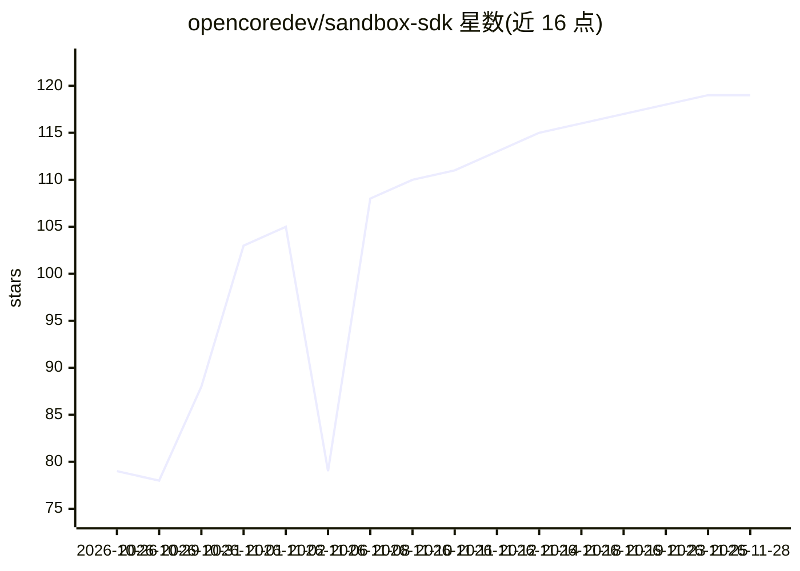

# opencoredev/sandbox-sdk

⭐ 119 · TypeScript · MIT · 推送 2026-11-27 · [GitHub](https://github.com/opencoredev/sandbox-sdk) · [官网](https://sandbox-sdk.app) · 组织维护

**为 TypeScript 开发者统一各沙箱云的代码执行 API**

面向服务端 TypeScript 的沙箱抽象层 SDK：用同一套 API 在 15 个云沙箱提供方（E2B、Daytona、Vercel Sandbox、Upstash Box、Railway 等）、本地 Docker 或进程内实现上创建沙箱、运行命令、读写文件、启动开发服务器并获取预览 URL，切换提供方只需更换一个 import。提供 sandboxTools 将沙箱暴露为 agent 可调用的工具（run/读写文件/后台进程），适配 AI SDK、Mastra、OpenAI Agents SDK 等框架，注册的密钥不会传给模型。需 Node.js 22+ 或 Bun 1.3+，不支持 edge 运行时；部分提供方需额外安装其官方 SDK 作为可选 peer。MIT 许可，标注 EARLY_ACCESS。

## 筛选速览

| 维度 | 判定 | 备注 |
|---|---|---|
| AI 角色 | `ai-ecosystem` | LLM/agent 周边工具 |
| 许可风险 | `permissive` | MIT |
| 部署形态 | `self-host` | docker 或自建部署 |
| 模型依赖 | — | README 未给出锁定关系 |
| 硬件要求 | — | 无带数字的原话,不猜 |
| 安装摩擦 | `low` | 无编译、无系统依赖或容器化 |
| 成熟度 | `idea` | |

## 能力要点

- 一套 API 覆盖 15 个云沙箱提供方，切换只需改一个 import
- sandboxTools 将沙箱转为 agent 工具，密钥不传给模型
- 支持 pause/resume/snapshot、按 key 复用沙箱、await using 自动清理
- 提供 Provider 接口与 runConformance 测试工具以接入自定义提供方

## 适用场景

- 为 AI agent 提供可运行命令和编辑文件的隔离沙箱
- 在多个沙箱云之间迁移而不重写业务代码
- 在本地 Docker 中运行不信任代码并锁定权限
- 为多用户应用按用户 key 维持各自的持久沙箱

## 场景标签

`Agent 框架` · 领域:Agent 开发

## 证据(README 行号)

> L11: Sandbox SDK gives your server-side TypeScript one API for creating sandboxes, running commands, editing files and s
> L62: `sandboxTools` turns a sandbox into tools an agent can call: `run`, `read_file`, `write_file`, `edit_file`, and bac

## 星数曲线

2026-10-26 79 → 2026-11-28 119（+40）

---
*卡片 v1 · prompt 1.4 · 生成 2026-11-28 · 置信度 mid · 依据 README sha `894b2fab09b6` · [字段定义](../../DATASET.md)*
