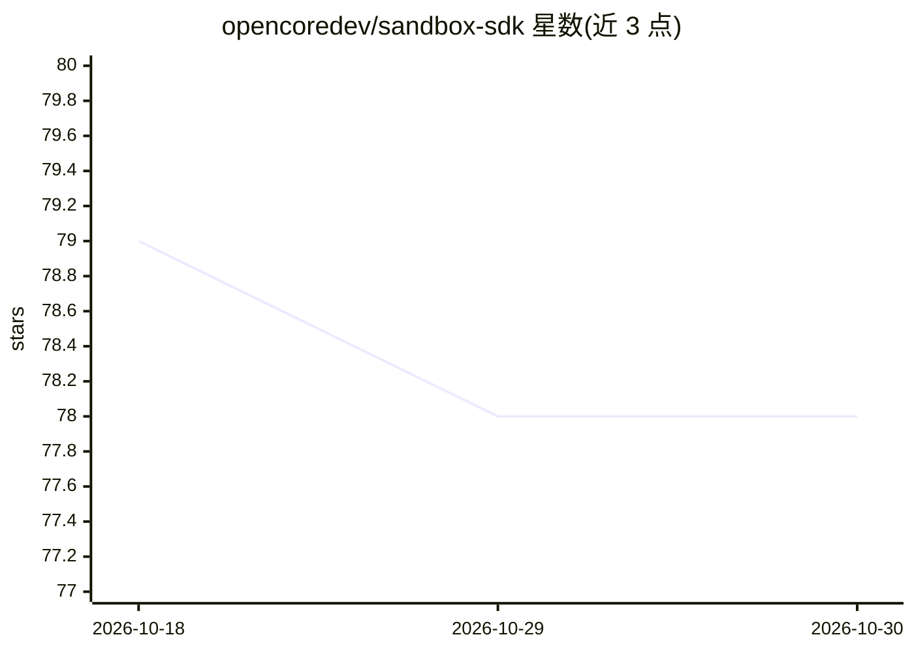

# opencoredev/sandbox-sdk

⭐ 78 · TypeScript · MIT · 推送 2026-10-23 · [GitHub](https://github.com/opencoredev/sandbox-sdk) · [官网](https://sandbox-sdk.app) · 组织维护

**TypeScript 沙箱 SDK：一套 API 在多家运行商上执行代码**

开源 TypeScript SDK，提供统一类型化 API 在隔离沙箱中运行代码，支持 Local、E2B、Daytona、Vercel Sandbox、Upstash Box、Ascii Box、Railway、Tenki 共 8 种提供商；Local 内置使用 AgentOS VM，云端提供商走各自官方 SDK 与凭据。面向构建编码代理与隔离任务的开发者，通过 bun/npm 安装，需 Node.js 22/24 或 Bun 1.3+，使用 await using 语法自动停止沙箱。

## 筛选速览

| 维度 | 判定 | 备注 |
|---|---|---|
| AI 角色 | `ai-ecosystem` | LLM/agent 周边工具 |
| 许可风险 | `permissive` | MIT |
| 部署形态 | `None` |  |
| 模型依赖 | — | README 未给出锁定关系 |
| 硬件要求 | — | 无带数字的原话,不猜 |
| 安装摩擦 | `low` | 无编译、无系统依赖或容器化 |
| 成熟度 | — | 结构信号不足 |

## 能力要点

- 一套类型化 API 覆盖 8 种沙箱提供商
- Local 提供商（AgentOS VM）内置，支持开发、CI 与自托管
- await using 作用域退出时自动停止沙箱，含异常路径

## 适用场景

- 让 AI 编码代理在隔离沙箱中执行代码
- 同一套沙箱代码在本地与多家云端提供商间切换
- 运行需要隔离的一次性任务与持久化工作区

## 场景标签

`Agent 框架` · 领域:Agent 开发

## 证据(README 行号)

> L3: Run the same TypeScript sandbox code on Local, E2B, Daytona, Vercel Sandbox, Upstash Box, Ascii Box, Railway Sandbox
> L29: |Provider|Runtime|Best for|
> L40: Local is included. Cloud providers use their official SDKs and credentials.

## 星数曲线

2026-10-18 79 → 2026-10-30 78（-1）

---
*卡片 v1 · prompt 1.4 · 生成 2026-10-24 · 置信度 high · 依据 README sha `d789d810fa1d` · [字段定义](../../DATASET.md)*
