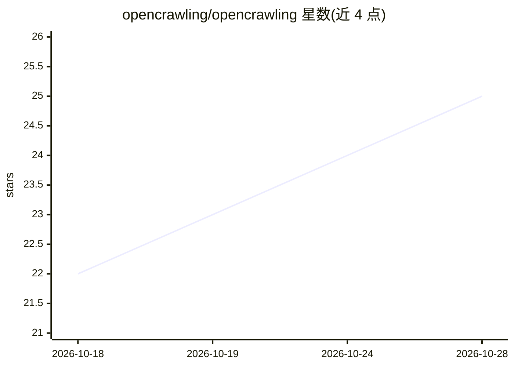

# opencrawling/opencrawling

⭐ 25 · Java · Apache-2.0 · 推送 2026-10-27 · [GitHub](https://github.com/opencrawling/opencrawling) · [官网](https://opencrawling.org) · 组织维护

**面向企业的数据摄取平台：仓库连接器到向量检索的数据流编排**

Open Ingestion Standard (OIS) 的 Java/Spring 参考实现：通过仓库连接器（SharePoint、S3、文件系统、Iceberg 等）抓取文档，经 Kafka 编排扫描/抽取/分块/嵌入流水线，输出到 Milvus、Qdrant、OpenSearch、Vespa 等向量与搜索引擎。使用 Java 25 虚拟线程、gRPC 可选内部传输、OpenTelemetry 追踪，提供 React 管理界面、CLI（oc）、MCP 诊断工具与基于 Spring AI 的根因分析和模板生成 Copilot（默认调用 Ollama）。面向企业搜索与 RAG 数据集成场景。

## 筛选速览

| 维度 | 判定 | 备注 |
|---|---|---|
| AI 角色 | `ai-ecosystem` | LLM/agent 周边工具 |
| 许可风险 | `permissive` | Apache-2.0 |
| 部署形态 | `self-host` | docker 或自建部署 |
| 模型依赖 | local-ok | 支持本地模型 |
| 硬件要求 | — | 无带数字的原话,不猜 |
| 安装摩擦 | `low` | 无编译、无系统依赖或容器化 |
| 成熟度 | — | 结构信号不足 |

## 能力要点

- OIS 参考实现：仓库连接器→分块/嵌入→向量搜索输出的摄取流水线
- Java 25 虚拟线程与结构化并发，gRPC 可选内部传输（AUTO/GRPC/REST 模式）
- AIOps：OTel span 关联的 AI 根因分析，Admin Copilot 暴露原生 MCP 工具
- Auto-Narrativization Copilot 从数据集 schema 生成 Mustache 模板与 mock 数据

## 适用场景

- 把企业内容仓库（SharePoint/S3/文件系统）批量摄取到向量库供搜索或 RAG 使用
- 通过 Admin UI 或 CLI 监控、调度与诊断摄取作业
- 对流水线故障做 AI 根因分析

## 场景标签

`网页抓取` `文档解析` · 领域:效率与自动化

## 证据(README 行号)

> L47: **OpenCrawling** is the reference Java and Spring Framework implementation of the **Open Ingestion Standard (OIS)**
> L86: *Configure target models (e.g., Ollama, OpenAI) and tune text chunk sizes/overlap boundaries dynamically.*

## 星数曲线

2026-10-18 22 → 2026-10-28 25（+3）

---
*卡片 v1 · prompt 1.4 · 生成 2026-10-27 · 置信度 mid · 依据 README sha `2734a8782787` · [字段定义](../../DATASET.md)*
