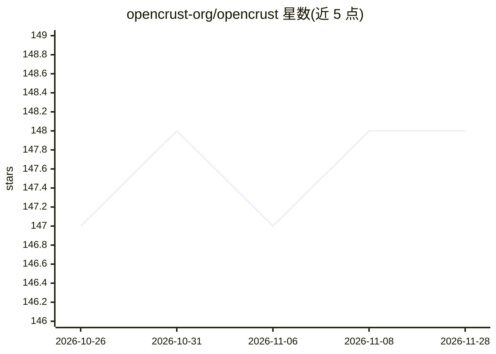

# opencrust-org/opencrust

⭐ 148 · Rust · MIT · 推送 2026-11-08 · [GitHub](https://github.com/opencrust-org/opencrust) · 组织维护 · 中文 README

**单二进制的个人多 agent 助手平台，接入 9 个聊天渠道**

用 Rust 编写的 AI agent 框架，编译为单个 16 MB 二进制文件，空闲内存 13 MB。功能覆盖多 agent 路由、跨会话自学习技能（Markdown SKILL.md，含 prompt 注入扫描与生命周期归档）、文档 RAG（SQLite + 向量/关键词混合检索）、MCP 服务器接入（Stdio/HTTP）以及 Telegram、Discord、Slack、WhatsApp、LINE、微信、iMessage、MQTT 共 9 个渠道接入。安全机制包括 AES-256-GCM 加密凭证库、默认认证、速率限制与 token 预算。

## 筛选速览

| 维度 | 判定 | 备注 |
|---|---|---|
| AI 角色 | `ai-ecosystem` | LLM/agent 周边工具 |
| 许可风险 | `permissive` | MIT |
| 部署形态 | `None` |  |
| 模型依赖 | local-ok | 支持本地模型 |
| 硬件要求 | — | 无带数字的原话,不猜 |
| 安装摩擦 | `medium` | 含编译或系统依赖之一 |
| 成熟度 | — | 结构信号不足 |

## 能力要点

- 16 MB 单二进制，空闲内存 13 MB，凭证 AES-256-GCM 加密存储
- 接入 Telegram/Discord/Slack/WhatsApp/LINE/微信/iMessage 等 9 个渠道
- 自学习技能系统：重复工作流 5 次以上自动沉淀为技能，安装前做 prompt 注入扫描
- 文档 RAG：!ingest 摄取 PDF/Markdown/CSV 等，混合检索并引用来源

## 适用场景

- 在 Telegram/微信等聊天渠道上运行个人 AI 助手
- 让 agent 摄取本地文档后引用内容回答问题
- 定义多个命名 agent 并通过 handoff 工具互相转交任务
- 安装社区技能并让 agent 跨会话沉淀自己的工作流

## 场景标签

`AI 助手` `聊天机器人` `多智能体` `RAG` · 领域:Agent 开发

## 证据(README 行号)

> L5:  The secure, lightweight open-source AI agent framework.
> L27: A single 16 MB binary that runs your AI agents across Telegram, Discord, Slack, WhatsApp, WhatsApp Web, LINE, WeCha
> L177: ### Agent Runtime

## 星数曲线

2026-10-26 147 → 2026-11-28 148（+1）

---
*卡片 v1 · prompt 1.4 · 生成 2026-11-27 · 置信度 high · 依据 README sha `842400d31ffb` · [字段定义](../../DATASET.md)*
