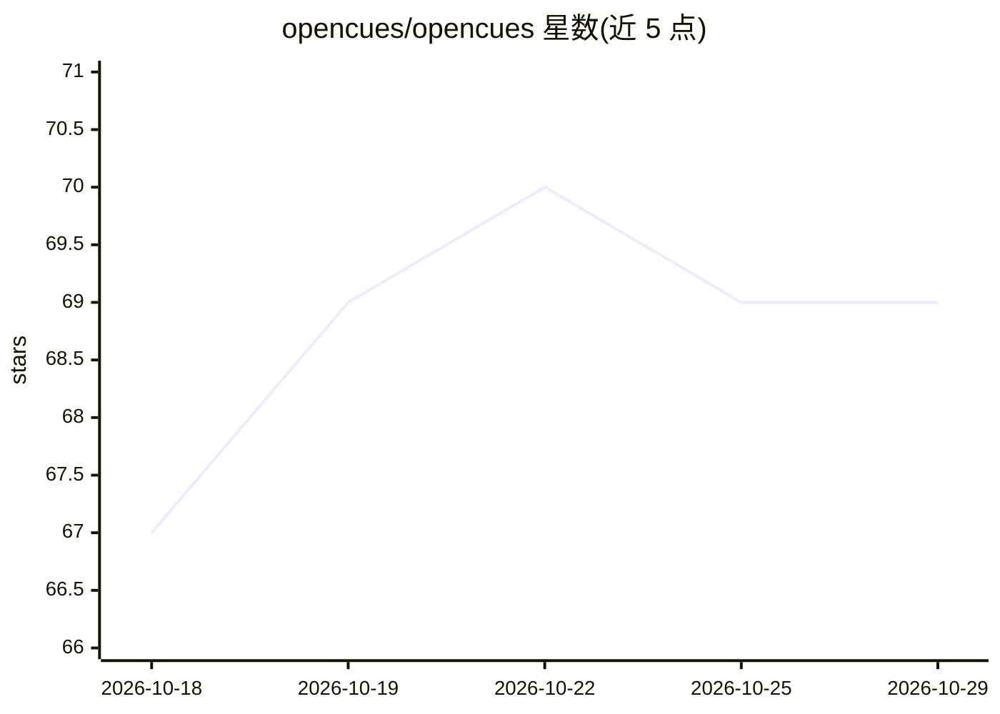

# opencues/opencues

⭐ 69 · TypeScript · Apache-2.0 · 推送 2026-10-25 · [GitHub](https://github.com/opencues/opencues) · [官网](https://www.opencues.com) · 个人维护

**把任意文本框变成双向 LLM 通道的内联 AI 标准与 CLI**

OpenCues 以 CLI 与集成方式，把 Claude Code、OpenCode、Gemini CLI、Chrome、Shell、DeepSeek Harness 等宿主中的文本输入变成双向 LLM 通道：Cues 在输入时主动提示修正或补充信息，Blanks 以行尾 `_` 触发模型补全生成。平台与模型无关，支持七家提供商（含 Cerebras、Groq、Gemini、Anthropic、OpenAI），输出先经用户审阅再提交；无工具执行层，第三方 blank JS 在 isolated-vm 沙箱运行。npm 全局安装，需 Node 22+ 与 git；Windows 需 WSL2。

## 筛选速览

| 维度 | 判定 | 备注 |
|---|---|---|
| AI 角色 | `ai-native` | 本体是模型或模型工具 |
| 许可风险 | `permissive` | Apache-2.0 |
| 部署形态 | `library` | 以包/库形式分发 |
| 模型依赖 | locked-api |  |
| 硬件要求 | — | 无带数字的原话,不猜 |
| 安装摩擦 | `medium` | 含编译或系统依赖之一 |
| 成熟度 | — | 结构信号不足 |

## 能力要点

- Cues 主动提示 + Blanks（行尾 `_`）按需生成的双向内联机制
- 六种宿主集成（Claude Code/OpenCode/Gemini CLI/Chrome/Shell/DSH），各自 pin 独立 fork 不动原生安装
- 七家 LLM 提供商支持，输出经用户审阅后提交
- 无 LLM 工具执行层，第三方代码在 isolated-vm 沙箱运行并有能力门控与资源配额

## 适用场景

- 在 Claude Code 或终端里输入时即时获得拼写/事实纠错与改写建议
- 用 `_` 让模型在当前文本框内补全翻译、邮件、命令
- 跨多个编码宿主统一使用同一套内联 AI 行为

## 场景标签

`AI 写作` · 领域:内容生成

## 证据(README 行号)

> L9: **Turn any text field into a two-way LLM channel.** It reads what you write and fills what you ask: catching a slip 
> L11: The model comes to your cursor, both ways. **Cues** react to what you've already written and surface a fix or a sha
> L77: |**Blanks**|Type `_` for free-form generation, translation, formatting, full rewrites, or keyword-bound system acti

## 星数曲线

2026-10-18 67 → 2026-10-29 69（+2）

---
*卡片 v1 · prompt 1.4 · 生成 2026-10-24 · 置信度 high · 依据 README sha `6a51bc8d65f0` · [字段定义](../../DATASET.md)*
