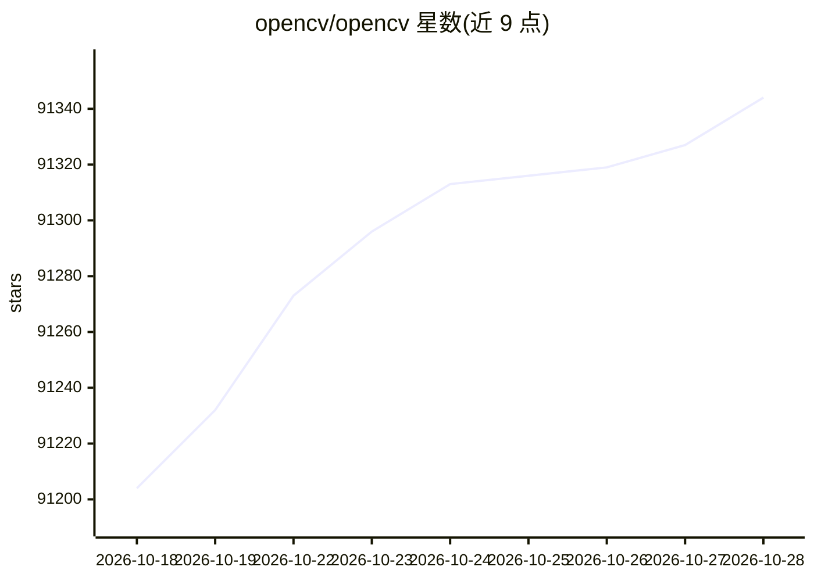

# opencv/opencv

⭐ 91,344 · C++ · Apache-2.0 · 推送 2026-10-27 · [GitHub](https://github.com/opencv/opencv) · [官网](https://opencv.org) · 组织维护

**开源计算机视觉库：提供图像处理与视觉算法**

OpenCV 是开源计算机视觉库，README 提供主页、文档（5.x）、课程、问答论坛、issue 跟踪及附加功能模块 opencv_contrib 的链接。仓库以 C++ 为主（主题标签含 c-plus-plus），主题标签还涉及计算机视觉、深度学习与图像处理。README 本身不包含安装步骤或 API 说明，仅给出资源入口与贡献指南摘要（每个 issue 一个 PR、需含测试与文档、遵循编码风格等）。

## 筛选速览

| 维度 | 判定 | 备注 |
|---|---|---|
| AI 角色 | `ai-enhanced` | 去掉 AI 部分产品仍成立 |
| 许可风险 | `permissive` | Apache-2.0 |
| 部署形态 | `None` |  |
| 模型依赖 | — | README 未给出锁定关系 |
| 硬件要求 | — | 无带数字的原话,不猜 |
| 安装摩擦 | `low` | 无编译、无系统依赖或容器化 |
| 成熟度 | — | 结构信号不足 |

## 动量与使用信号

- 维护:`active` — 距上次 push 1.6 天,年发版 3,285 位贡献者
- 涨星:近 1 天 **+3**(自 20261016 起算)

## 能力要点

- 提供在线文档（docs.opencv.org 5.x）与问答论坛入口
- 附加功能通过 opencv_contrib 仓库提供
- 以 C++ 为主，主题标签覆盖计算机视觉、深度学习、图像处理

## 适用场景

- 需要图像处理与计算机视觉算法的 C++ 开发
- 查找 OpenCV 文档与社区支持渠道
- 基于 OpenCV 开发项目并参与社区（Community Friday）

## 场景标签

`图像视频处理` · 领域:感知与多模态

## 证据(README 行号)

> L1: ## OpenCV: Open Source Computer Vision Library
> L7: * Docs: <https://docs.opencv.org/5.x/>
> L28: * Follow OpenCV on LinkedIn for daily posts showing the state-of-the-art in computer vision & AI

## 星数曲线

2026-10-18 91,204 → 2026-10-28 91,344（+140）

---
*卡片 v1 · prompt 1.4 · 生成 2026-10-18 · 置信度 mid · 依据 README sha `ef41f5c643f2` · [字段定义](../../DATASET.md)*
