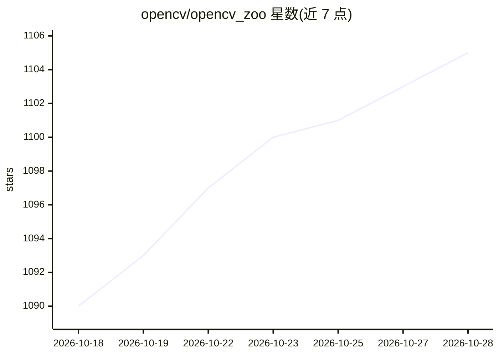

# opencv/opencv_zoo

⭐ 1,105 · Python · Apache-2.0 · 推送 2026-10-20 · [GitHub](https://github.com/opencv/opencv_zoo) · 组织维护

**面向 OpenCV DNN 调优的模型库与多平台推理基准**

OpenCV 官方维护的模型动物园：收录人脸检测/识别、表情识别、人体分割、目标检测与跟踪、手势/姿态估计、二维码检测、中英文文本检测等模型，均为适配 OpenCV DNN 的调优版本，并附带演示脚本。在 x86-64、ARM、RISC-V 等约 15 种硬件（含多款 NPU 开发板）上给出单张推理耗时基准，用户可在自己的硬件上复跑。通过 pip 安装 opencv-python 并 git clone 拉取模型使用；项目已迁移至 Hugging Face 托管模型与在线演示。

## 筛选速览

| 维度 | 判定 | 备注 |
|---|---|---|
| AI 角色 | `ai-knowledge` | 知识聚合/清单类 |
| 许可风险 | `permissive` | Apache-2.0 |
| 部署形态 | `library` | 以包/库形式分发 |
| 模型依赖 | — | README 未给出锁定关系 |
| 硬件要求 | — | 无带数字的原话,不猜 |
| 安装摩擦 | `low` | 无编译、无系统依赖或容器化 |
| 成熟度 | — | 结构信号不足 |

## 能力要点

- 覆盖人脸/目标/姿态/文本等多类视觉任务的模型与演示脚本
- x86-64/ARM/RISC-V 约 15 种硬件平台的推理耗时基准
- 支持 TIM-VX、CANN 等 NPU 后端构建 OpenCV 运行量化模型

## 适用场景

- 查找适配 OpenCV DNN 的预训练视觉模型
- 对比不同 CPU/NPU 硬件上的模型推理耗时
- 直接运行人脸检测、目标跟踪等演示脚本

## 场景标签

`模型评测` `人脸识别` `目标检测` · 领域:评测与运维

## 证据(README 行号)

> L5: A zoo for models tuned for OpenCV DNN with benchmarks on different platforms.
> L24: ## Models & Benchmark Results

## 星数曲线

2026-10-18 1,090 → 2026-10-28 1,105（+15）

---
*卡片 v1 · prompt 1.4 · 生成 2026-10-21 · 置信度 mid · 依据 README sha `16c24bf65f7c` · [字段定义](../../DATASET.md)*
