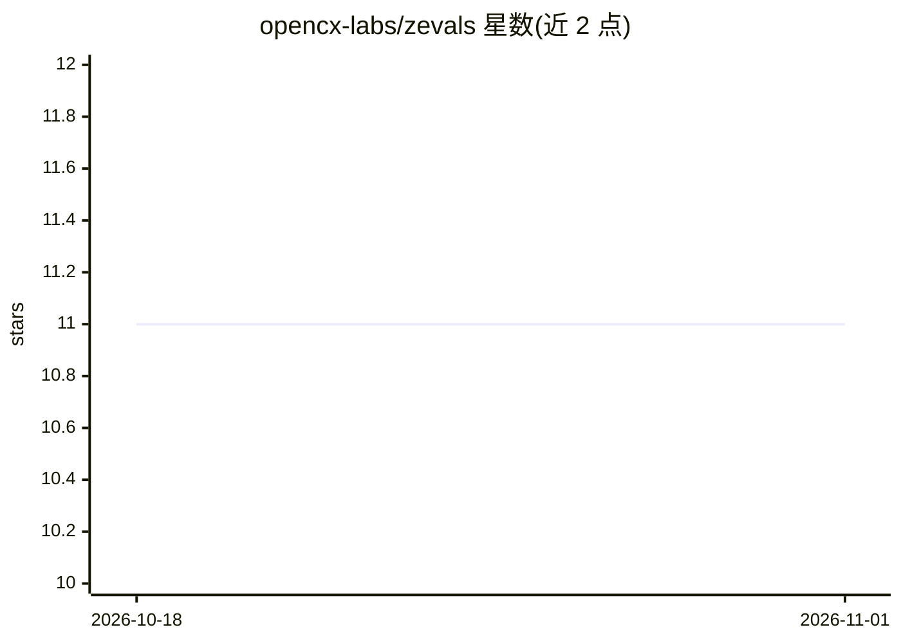

# opencx-labs/zevals

⭐ 11 · TypeScript · MIT · 推送 2026-10-22 · [GitHub](https://github.com/opencx-labs/zevals) · 组织维护

**TypeScript AI agent 评测库：以二元断言测试完整对话**

面向 TypeScript 开发者的 AI agent 测试工具库：将 AI 评测视作端到端测试，以二元断言为核心而非指标聚合；支持整段会话（而非单轮问答）评测、LLM-as-a-judge、用户模拟、确定性动态消息、工具调用断言与 repeat 重复运行。可选通过 LangChain 或 Vercel AI SDK 接入任意 LLM 提供方，另可接入 TypeSafe 的 Jev 概率判定模型（经 OpenRouter/Vercel/Cloudflare 网关，32k token 上下文限制）。不绑定测试框架，npm 安装，MIT 许可。

## 筛选速览

| 维度 | 判定 | 备注 |
|---|---|---|
| AI 角色 | `ai-ecosystem` | LLM/agent 周边工具 |
| 许可风险 | `permissive` | MIT |
| 部署形态 | `library` | 以包/库形式分发 |
| 模型依赖 | — | README 未给出锁定关系 |
| 硬件要求 | — | 无带数字的原话,不猜 |
| 安装摩擦 | `low` | 无编译、无系统依赖或容器化 |
| 成熟度 | `idea` | |

## 能力要点

- 整段会话评测与可选的用户模拟（userSimulation/dynamicMessage）
- LLM-as-a-judge 与程序化工具调用断言（Criterion 可组合）
- Jev 概率判定客户端：约 0.5s、~$0.00005/次，支持 threshold 与 borderline 标记
- 不强制测试框架，可选接入 LangChain / Vercel AI SDK / Braintrust autoevals

## 适用场景

- 为 TypeScript AI agent 编写端到端对话测试
- 用 LLM 或 Jev 判定 agent 是否完成预期行为
- 以用户模拟验证多轮交互场景与 handoff 工具调用

## 场景标签

`模型评测` · 领域:评测与运维

## 证据(README 行号)

> L7: Zevals provides utilities for testing AI agents. Unlike the few existing AI eval libraries and frameworks:
> L41: - (Optionally) integrates with any LLM provider via LangChain or Vercel AI SDK

## 星数曲线

2026-10-18 11 → 2026-11-01 11（+0）

---
*卡片 v1 · prompt 1.4 · 生成 2026-11-01 · 置信度 high · 依据 README sha `d8095436ffae` · [字段定义](../../DATASET.md)*
