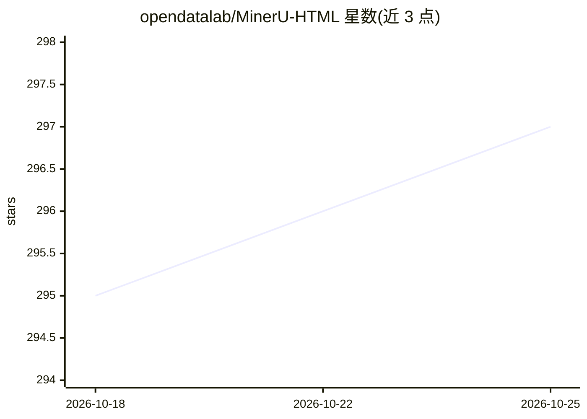

# opendatalab/MinerU-HTML

⭐ 298 · Python · Apache-2.0 · 推送 2026-03-27 · [GitHub](https://github.com/opendatalab/MinerU-HTML) · [官网](https://opendatalab.com/ai-ready/AICC#playground) · 组织维护 · 中文 README

**基于 LLM 的 HTML 主体内容抽取工具，输出干净 HTML 正文**

MinerU-HTML(Dripper) 使用基于 Qwen3 微调的 LLM 与状态机引导的 logits 处理，从 HTML 页面中抽取主体内容并输出结构化结果；出错时自动回退到 trafilatura 等备选抽取器。提供 Python API 与 FastAPI REST 服务，支持 Ray 分布式处理与内置 ROUGE 评测框架。面向需要为 Deep Research Agent、RAG 或训练数据生成清洗网页内容的开发者，需自行下载模型权重，GPU 用于 LLM 推理为推荐配置。

## 筛选速览

| 维度 | 判定 | 备注 |
|---|---|---|
| AI 角色 | `ai-native` | 本体是模型或模型工具 |
| 许可风险 | `permissive` | Apache-2.0 |
| 部署形态 | `library` | 以包/库形式分发 |
| 模型依赖 | local-ok | 支持本地模型 |
| 硬件要求 | — | 无带数字的原话,不猜 |
| 安装摩擦 | `medium` | 含编译或系统依赖之一 |
| 成熟度 | — | 结构信号不足 |

## 能力要点

- LLM 分类 + 状态机引导的结构化 JSON 输出
- 错误时自动回退到 trafilatura 等备选抽取器
- 提供 Python API、FastAPI REST 服务与批量处理
- 内置 ROUGE 评测框架与 Ray 分布式并行处理

## 适用场景

- 为 Deep Research Agent 或 RAG 流水线抽取网页主体内容
- 批量清洗网页生成训练语料
- 与多个基线抽取器做抽取效果对比评测

## 场景标签

`网页抓取` `文档解析` · 领域:效率与自动化

## 证据(README 行号)

> L3: **MinerU-HTML(Dripper)** is an advanced HTML main content extraction tool based on Large Language Models (LLMs). It 
> L44: where * denotes that use GPT-5/Deepseek-V3 to extract the main html in MinerU-HTML framework instead of our finetun

## 星数曲线

2026-10-18 295 → 2026-10-25 297（+2）

---
*卡片 v1 · prompt 1.4 · 生成 2026-10-21 · 置信度 mid · 依据 README sha `e677ae2b8655` · [字段定义](../../DATASET.md)*
