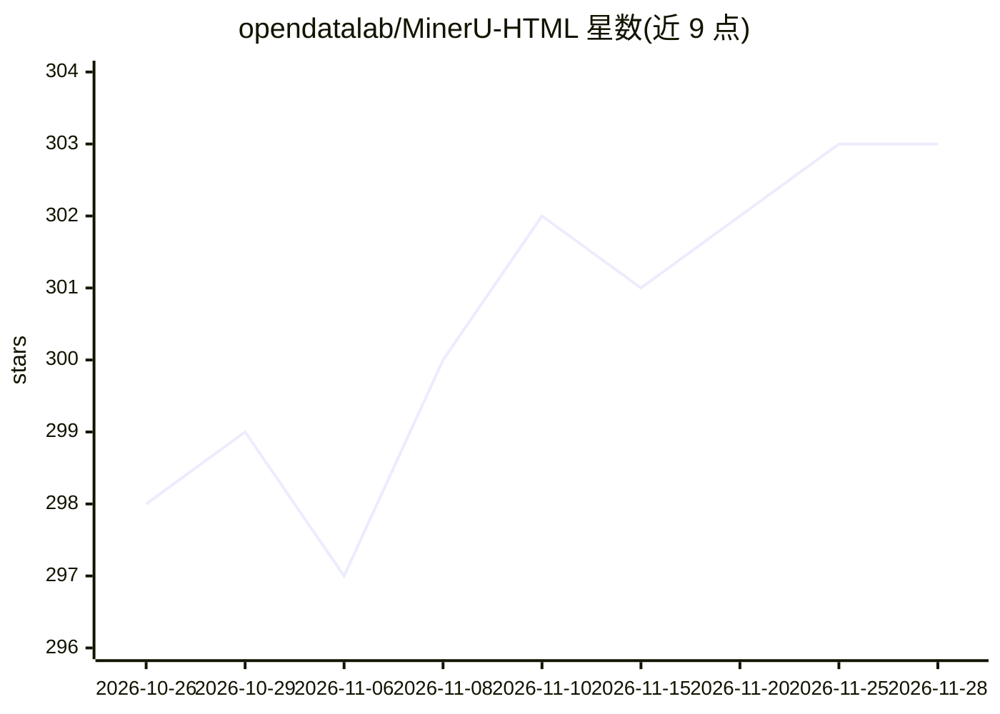

# opendatalab/MinerU-HTML

⭐ 303 · Python · Apache-2.0 · 推送 2026-11-06 · [GitHub](https://github.com/opendatalab/MinerU-HTML) · [官网](https://opendatalab.com/ai-ready/AICC#playground) · 组织维护 · 中文 README

**SLM 驱动的 HTML 正文提取工具，输出干净正文供 RAG 与语料构建**

基于小语言模型（微调的 Qwen3 系 0.8B、Hunyuan 0.5B 等检查点）的 HTML 正文抽取库：先简化 HTML 并为元素编号，再用 LLM 逐元素分类 main/other，解析后抽取正文，并可经 MinerU-Webkit 转为 Markdown/JSON/Txt；失败时回退到 trafilatura 等机制。支持 VLLM、Transformers、OpenAI API 三种推理后端，pip 安装，Apache-2.0 许可。面向需要网页正文语料的 RAG 应用、Deep Research Agent 与训练数据生成场景，附带 WebMainBench 评测流程。

## 筛选速览

| 维度 | 判定 | 备注 |
|---|---|---|
| AI 角色 | `ai-native` | 本体是模型或模型工具 |
| 许可风险 | `permissive` | Apache-2.0 |
| 部署形态 | `library` | 以包/库形式分发 |
| 模型依赖 | local-ok | 支持本地模型 |
| 硬件要求 | — | 无带数字的原话,不猜 |
| 安装摩擦 | `low` | 无编译、无系统依赖或容器化 |
| 成熟度 | — | 结构信号不足 |

## 能力要点

- LLM 逐元素分类的正文抽取流水线（简化→推理→解析→抽取→转换）
- 支持 VLLM/Transformers/OpenAI API 三种推理后端
- 带 trafilatura/bypass/empty 回退机制
- 配套 WebMainBench 评测与基线对比脚本

## 适用场景

- 为 RAG 知识库批量抽取网页正文并转 Markdown
- 为 Deep Research Agent 提供干净的页面主内容
- 生成 LLM 训练用的网页语料（如 AICC 数据集同款流程）
- 对多种正文抽取基线做 ROUGE 评测

## 场景标签

`网页抓取` `文档解析` `模型评测` · 领域:效率与自动化

## 证据(README 行号)

> L5: **MinerU-HTML** is an advanced HTML main content extraction tool based on Small Language Models (SLM). It can accura
> L29: - 🔄 **Complete Processing Pipeline**: Includes HTML simplification, prompt construction, LLM inference, result pars
> L30: - 🚀 **Multiple Inference Backend Support**: Supports three inference backends: VLLM, Transformers, and OpenAI API

## 星数曲线

2026-10-26 298 → 2026-11-28 303（+5）

---
*卡片 v1 · prompt 1.4 · 生成 2026-11-25 · 置信度 mid · 依据 README sha `7246bbed83d2` · [字段定义](../../DATASET.md)*
