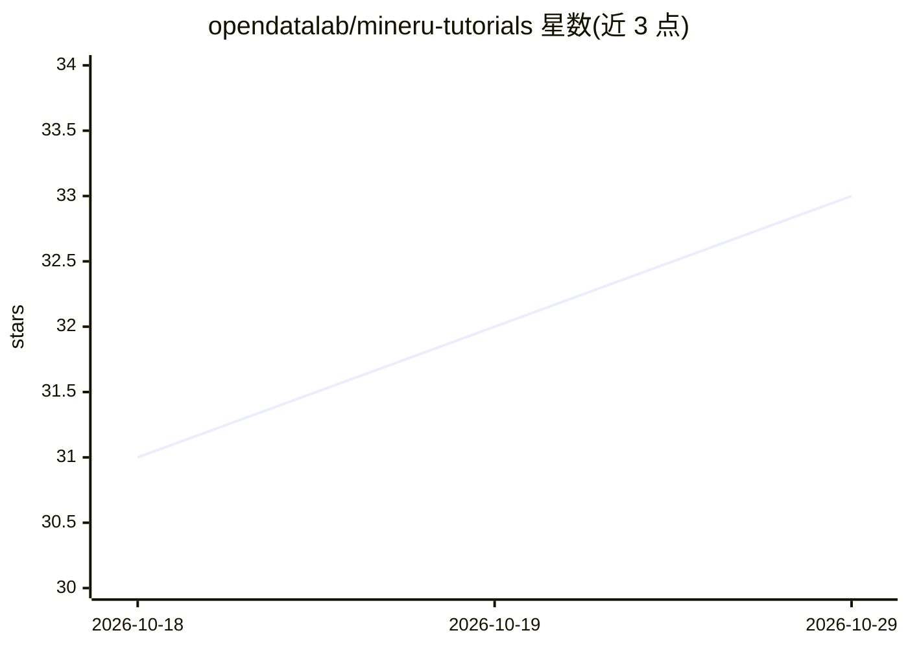

# opendatalab/mineru-tutorials

⭐ 33 · NOASSERTION · 推送 2026-05-11 · [GitHub](https://github.com/opendatalab/mineru-tutorials) · [官网](https://aicarrier.feishu.cn/wiki/Bv0GwrC26iCp5LkqBjHcM8mjnOe) · 组织维护 · 中文 README

**MinerU 训练营课程资料仓库：文档解析教学与实战教程**

OpenDataLab 维护的 MinerU 训练营课程材料合集，内容覆盖 MinerU 产品选型、本地与容器化部署、在线 API 使用、MinerU 1.2B 模型微调、OpenClaw Skill 开发、AI Agent 构建以及基于 OmniDocBench、Dingo、WebMainBench 的文档解析评测，共 00-08 九节课。材料形式为 Markdown 笔记、PDF 幻灯片与 Bilibili 视频链接，面向开发者、部署工程师与算法团队，仓库本身不提供软件，仅提供目录化的学习内容。

## 筛选速览

| 维度 | 判定 | 备注 |
|---|---|---|
| AI 角色 | `ai-knowledge` | 知识聚合/清单类 |
| 许可风险 | `none` | NOASSERTION |
| 部署形态 | `None` |  |
| 模型依赖 | — | README 未给出锁定关系 |
| 硬件要求 | — | 无带数字的原话,不猜 |
| 安装摩擦 | `low` | 无编译、无系统依赖或容器化 |
| 成熟度 | — | 结构信号不足 |

## 能力要点

- 课程覆盖 MinerU 部署、微调、OpenClaw Skill 与 Agent 开发
- 包含 OmniDocBench/Dingo/WebMainBench 三套评测工具的教学
- 课程材料含 Markdown 笔记、PDF 幻灯片与 Bilibili 视频

## 适用场景

- 系统学习 MinerU 产品矩阵并做场景化选型
- 跟随课程实践本地部署、Docker 部署与在线 API 调用
- 学习文档解析模型的微调与评测流程

## 场景标签

`教程课程` · 领域:学习与行业

## 证据(README 行号)

> L9: This repository contains the course materials for the MinerU Training Camp. The curriculum covers MinerU product sel
> L15: - Video links to the Bilibili course collection

## 星数曲线

2026-10-18 31 → 2026-10-29 33（+2）

---
*卡片 v1 · prompt 1.4 · 生成 2026-10-25 · 置信度 high · 依据 README sha `5e5041f6fa5d` · [字段定义](../../DATASET.md)*
