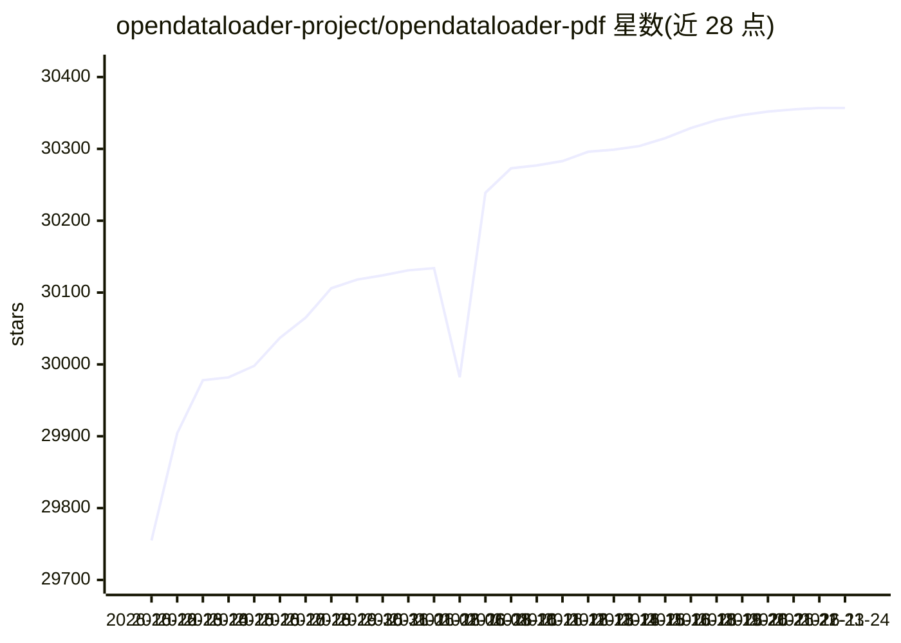

# opendataloader-project/opendataloader-pdf

⭐ 30,361 · Java · Apache-2.0 · 推送 2026-11-23 · [GitHub](https://github.com/opendataloader-project/opendataloader-pdf) · [官网](https://opendataloader.org) · 组织维护

**面向 AI 数据管道的 PDF 解析库：输出 Markdown/JSON/HTML**

从 PDF 提取 Markdown、带边界框的 JSON 和 HTML，核心为本地确定性布局分析（XY-Cut++ 阅读顺序、表格/标题/图像检测）；hybrid 模式将复杂页面路由到 AI 后端，提供 OCR（多引擎、多语言）、LaTeX 公式提取与图表描述。另支持将无标签 PDF 自动标记为屏幕阅读器可用的 Tagged PDF（Apache 2.0），PDF/UA 导出为付费企业附加功能。提供 Python/Node.js/Java SDK，运行需 Java 11+。

## 筛选速览

| 维度 | 判定 | 备注 |
|---|---|---|
| AI 角色 | `ai-native` | 本体是模型或模型工具 |
| 许可风险 | `permissive` | Apache-2.0 |
| 部署形态 | `library` | 以包/库形式分发 |
| 模型依赖 | — | README 未给出锁定关系 |
| 硬件要求 | `cpu-ok` | |
| 安装摩擦 | `medium` | 含编译或系统依赖之一 |
| 成熟度 | — | 结构信号不足 |

## 动量与使用信号

- 维护:`active` — 距上次 push 1.9 天,年发版 51,28 位贡献者
- 涨星:近 1 天 **+7**(自 20261016 起算)
- 安装:pypi 包 `opendataloader-pdf` 月下载 144,214

## 能力要点

- 本地确定性解析输出 Markdown/JSON（含边界框）/HTML
- hybrid 模式路由复杂页面至 AI 后端，支持 OCR、公式与图表描述
- 无标签 PDF 自动标记为 Tagged PDF，附提示注入过滤
- Python、Node.js、Java 三种 SDK 及 CLI

## 适用场景

- 把 PDF 批量转成 Markdown 供 RAG 分块检索
- 用带边界框的 JSON 做回答来源引用定位
- 批量将无标签 PDF 自动标记为无障碍 Tagged PDF
- 扫描件 OCR 与多语言文档解析

## 场景标签

`文档解析` · 领域:知识与检索

## 证据(README 行号)

> L13: 🔍 **PDF parser for AI data extraction** — Extract Markdown, JSON (with bounding boxes), and HTML from any PDF. #1 i
> L29: **Requires**: Java 11+ and Python 3.11+ (Node.js | Java also available)
> L64: |Table extraction (complex/borderless)|Yes|Free (Hybrid)|

## 星数曲线

2026-10-22 29,755 → 2026-11-24 30,357（+602）

---
*卡片 v1 · prompt 1.4 · 生成 2026-11-22 · 置信度 high · 依据 README sha `2329c69ec3d4` · [字段定义](../../DATASET.md)*
