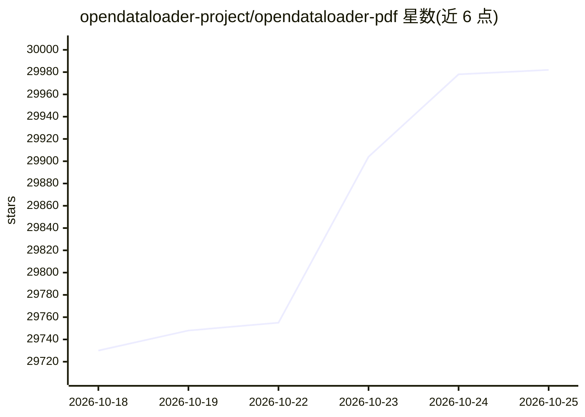

# opendataloader-project/opendataloader-pdf

⭐ 29,998 · Java · Apache-2.0 · 推送 2026-10-23 · [GitHub](https://github.com/opendataloader-project/opendataloader-pdf) · [官网](https://opendataloader.org) · 组织维护

**为 AI 数据管道解析 PDF 的开源工具：输出 Markdown/JSON/HTML**

Python/Node.js/Java 三种 SDK 提供的 PDF 解析器：本地确定性模式用 XY-Cut++ 阅读序与边界框坐标输出 Markdown、JSON、HTML；hybrid 模式将复杂页（复杂表格、扫描件、公式、图表）路由到 AI 后端处理，内置 80+ 语言 OCR。另提供无障碍功能：将未标记 PDF 自动标记为屏幕阅读器可用的 Tagged PDF（Apache 2.0），PDF/UA-1/2 导出为企业版附加项。依赖 Java 11+。

## 筛选速览

| 维度 | 判定 | 备注 |
|---|---|---|
| AI 角色 | `ai-enhanced` | 去掉 AI 部分产品仍成立 |
| 许可风险 | `dual` | Apache-2.0 |
| 部署形态 | `library` | 以包/库形式分发 |
| 模型依赖 | — | README 未给出锁定关系 |
| 硬件要求 | `cpu-ok` | |
| 安装摩擦 | `medium` | 含编译或系统依赖之一 |
| 成熟度 | — | 结构信号不足 |

## 动量与使用信号

- 维护:`active` — 距上次 push 1.9 天,年发版 51,28 位贡献者
- 涨星:近 1 天 **+7**(自 20261016 起算)
- 安装:pypi 包 `opendataloader-pdf` 月下载 144,214

## 能力要点

- 输出带边界框的 JSON、Markdown 与 HTML，支持 RAG 分块与来源引用
- hybrid 模式：简单页本地处理，复杂页路由到 AI 后端
- 内置 80+ 语言 OCR，支持 EasyOCR/RapidOCR/Tesseract/ocrmac 等多种 OCR 引擎
- 自动将未标记 PDF 生成 Tagged PDF（Apache 2.0 免费层）

## 适用场景

- 为 RAG 系统把 PDF 转成结构化 Markdown 并按标题层级分块
- 批量处理扫描件并提取带坐标的表格与公式
- 批量将未标记 PDF 转为屏幕阅读器可用的 Tagged PDF

## 场景标签

`文档解析` `OCR` · 领域:知识与检索

## 证据(README 行号)

> L13: 🔍 **PDF parser for AI data extraction** — Extract Markdown, JSON (with bounding boxes), and HTML from any PDF. #1 i
> L75: |Auto-tagging → Tagged PDF for untagged PDFs|Yes|Free (Apache 2.0)|
> L76: |PDF/UA-1, PDF/UA-2 export|💼 Available|Enterprise|

## 星数曲线

2026-10-18 29,730 → 2026-10-25 29,982（+252）

---
*卡片 v1 · prompt 1.4 · 生成 2026-10-18 · 置信度 mid · 依据 README sha `09f0dae8aade` · [字段定义](../../DATASET.md)*
