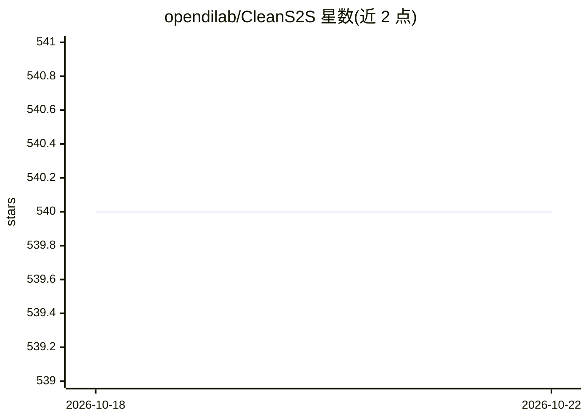

# opendilab/CleanS2S

⭐ 540 · Python · Apache-2.0 · 推送 2026-04-07 · [GitHub](https://github.com/opendilab/CleanS2S) · 组织维护 · 中文 README

**单文件实现的流式全双工中文语音交互原型智能体**

CleanS2S 是一个 Speech-to-Speech（语音到语音）原型智能体，把 ASR（paraformer-zh 等）、LLM（默认 DeepSeek API，可换 OpenAI 兼容接口或本地模型）、TTS（CosyVoice-300M）以及基于 WebSocket 的收发组件放进单个 Python 文件，实现实时流式全双工对话，支持打断、主观行动判断、Web 搜索与 RAG 增强。面向想快速体验 LUI 与验证 S2S 流水线的研究者与开发者；后端 Python，前端为 Next.js，可作为参考实现修改扩展各组件。

## 筛选速览

| 维度 | 判定 | 备注 |
|---|---|---|
| AI 角色 | `ai-native` | 本体是模型或模型工具 |
| 许可风险 | `permissive` | Apache-2.0 |
| 部署形态 | `self-host` | docker 或自建部署 |
| 模型依赖 | locked-api |  |
| 硬件要求 | — | 无带数字的原话,不猜 |
| 安装摩擦 | `low` | 无编译、无系统依赖或容器化 |
| 成熟度 | — | 结构信号不足 |

## 能力要点

- ASR+LLM+TTS 流水线集中于单个 Python 文件实现
- 基于 WebSocket 的实时流式全双工交互并支持语音打断
- 集成 Web 搜索与 RAG（Serper + 向量检索）增强回答
- 默认走 LLM API，可切换 OpenAI 兼容接口或本地 LLM（DeepSeek-V2.5、Qwen2.5 等）

## 适用场景

- 体验和验证中文流式语音对话（S2S）流水线
- 在其单文件实现上替换模型或添加组件做原型迭代
- 搭建带打断与全双工交互的语音智能体演示

## 场景标签

`语音 Agent` · 领域:对话与助手

## 证据(README 行号)

> L50: The whole S2S pipeline is mainly composed of `ASR` (Automatic Speech Recognition, or named Speech to Text), `LLM` (
> L56: Based on the powerful mechanisms provided by WebSockets, the pipeline supports full-duplex interaction, which means

## 星数曲线

2026-10-18 540 → 2026-10-22 540（+0）

---
*卡片 v1 · prompt 1.4 · 生成 2026-10-21 · 置信度 high · 依据 README sha `f51db8fe5468` · [字段定义](../../DATASET.md)*
