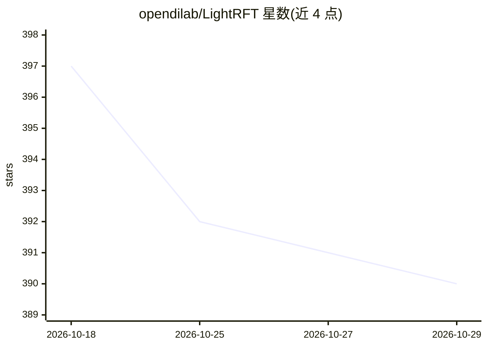

# opendilab/LightRFT

⭐ 390 · Python · Apache-2.0 · 推送 2026-09-07 · [GitHub](https://github.com/opendilab/LightRFT) · [官网](https://opendilab.github.io/LightRFT) · 组织维护 · 中文 README

**面向 LLM/VLM 的轻量强化微调训练框架**

面向大语言模型与视觉/多模态生成模型的强化微调（RFT）训练框架：以统一 Strategy 接口连接 FSDP v2 / DeepSpeed ZeRO 训练后端与 SGLang / vLLM rollout 后端，通过 torchrun 启动 SPMD 分布式作业，训练与 rollout 复用同一 GPU 进程集。覆盖 GRPO、DAPO、Dr.GRPO、PPO/GAE、REINFORCE++ 等算法，支持规则奖励、本地/远程奖励模型与在线策略蒸馏（OPD），并提供文本、图像、视频、音频任务示例。限制：GSPO/GMPO 为 WIP；需要 Python≥3.12、PyTorch≥2.9.1 与 CUDA GPU 环境。

## 筛选速览

| 维度 | 判定 | 备注 |
|---|---|---|
| AI 角色 | `ai-ecosystem` | LLM/agent 周边工具 |
| 许可风险 | `permissive` | Apache-2.0 |
| 部署形态 | `self-host` | docker 或自建部署 |
| 模型依赖 | local-ok | 支持本地模型 |
| 硬件要求 | — | 无带数字的原话,不猜 |
| 安装摩擦 | `low` | 无编译、无系统依赖或容器化 |
| 成熟度 | `idea` | |

## 能力要点

- 统一 Strategy 接口对接 FSDP v2/DeepSpeed 训练后端与 SGLang/vLLM rollout 后端
- 算法矩阵覆盖 GRPO、DAPO、Dr.GRPO、REINFORCE++、CPGD、FIRE Sampling、OPD 蒸馏
- 训练与 rollout 同 GPU 进程分相位复用（Colocate Anything），rollout 引擎可在更新期休眠
- 奖励来源支持规则、自定义函数、本地奖励模型与远程奖励服务

## 适用场景

- 在 GSM8K 等任务上对 LLM 做 GRPO/DAPO 等强化微调
- 对视觉语言模型做带奖励模型的 RL 训练与在线策略蒸馏
- 在同一 GPU 集上以分相位方式复用训练与推理资源

## 场景标签

`强化学习` `微调` · 领域:训练与推理

## 证据(README 行号)

> L16: LightRFT (Light Reinforcement Fine-Tuning) is a reinforcement fine-tuning framework for large language models (LLMs
> L18: LightRFT uses `torchrun` and PyTorch distributed communication as its runtime foundation. A unified Strategy interf
> L28: - A common interface connects DeepSpeed/FSDP v2 training backends with SGLang/vLLM rollout backends, reducing backe

## 星数曲线

2026-10-18 397 → 2026-10-29 390（-7）

---
*卡片 v1 · prompt 1.4 · 生成 2026-10-22 · 置信度 high · 依据 README sha `045c6f043551` · [字段定义](../../DATASET.md)*
