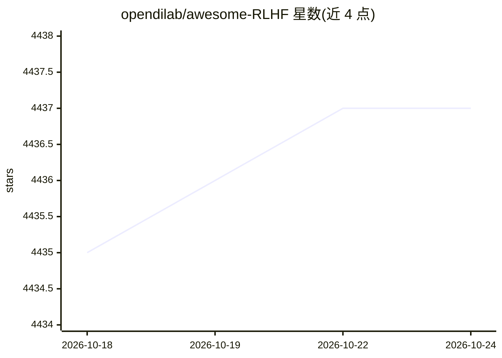

# opendilab/awesome-RLHF

⭐ 4,438 · Apache-2.0 · 推送 2026-05-20 · [GitHub](https://github.com/opendilab/awesome-RLHF) · 组织维护 · 中文 README

**RLHF 研究论文策展清单：持续追踪人类反馈强化学习前沿**

opendilab 维护的 RLHF（基于人类反馈的强化学习）研究资源聚合仓库：收录按年份组织的论文条目，每条含标题、作者与关键词（DPO/PPO/Reward Model/Alignment 等），覆盖 LLM 对齐与视频游戏两类应用。提供 RLHF 概念综述（含 IRL、HITLRL 等技术说明）与固定条目格式，承诺持续更新。本仓库为纯清单，无可安装代码。

## 筛选速览

| 维度 | 判定 | 备注 |
|---|---|---|
| AI 角色 | `ai-knowledge` | 知识聚合/清单类 |
| 许可风险 | `permissive` | Apache-2.0 |
| 部署形态 | `None` |  |
| 模型依赖 | — | README 未给出锁定关系 |
| 硬件要求 | — | 无带数字的原话,不猜 |
| 安装摩擦 | `low` | 无编译、无系统依赖或容器化 |
| 成熟度 | — | 结构信号不足 |

## 能力要点

- 按年份组织的 RLHF 论文清单，条目含作者与关键词标注
- 提供 RLHF 概念与技术综述（IRL/Apprenticeship Learning/HITLRL 等）
- 持续更新承诺（continually updated）

## 适用场景

- 查找 RLHF 与偏好优化方向的研究论文
- 了解 RLHF 在 LLM 对齐与游戏领域的应用图景
- 按关键词（DPO/Reward Model/Alignment）筛选相关工作

## 场景标签

`精选清单` · 领域:学习与行业

## 证据(README 行号)

> L4: This is a collection of research papers for **Reinforcement Learning with Human Feedback** (RLHF).
> L51: ## Papers

## 星数曲线

2026-10-18 4,435 → 2026-10-24 4,437（+2）

---
*卡片 v1 · prompt 1.4 · 生成 2026-10-20 · 置信度 high · 依据 README sha `e07198f3e8c3` · [字段定义](../../DATASET.md)*
