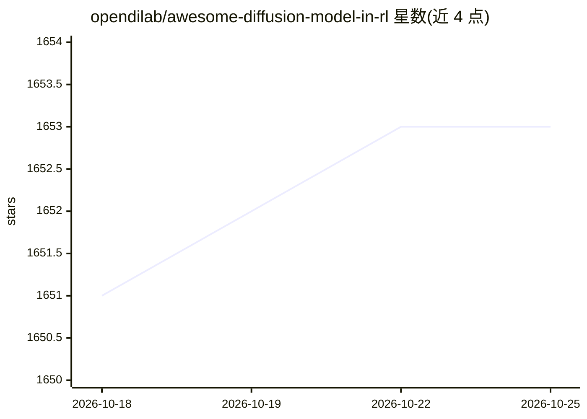

# opendilab/awesome-diffusion-model-in-rl

⭐ 1,653 · Apache-2.0 · 推送 2026-05-30 · [GitHub](https://github.com/opendilab/awesome-diffusion-model-in-rl) · 组织维护 · 中文 README

**扩散模型与强化学习交叉领域论文清单（持续更新）**

由 OpenDILab 维护的研究论文汇编，收集 Diffusion Model 在强化学习中应用的文献：涵盖轨迹规划、扩散策略、世界模型、模仿学习、数据合成等方向，并扩展到 flow matching 相关工作。条目按 Arxiv、ICML 2026、ICLR 2026、NeurIPS 2025 等发表渠道组织，每条含作者、关键词与实验环境（D4RL、OGBench、MuJoCo 等），部分标注代码链接。面向该方向的研究者跟踪前沿。

## 筛选速览

| 维度 | 判定 | 备注 |
|---|---|---|
| AI 角色 | `ai-knowledge` | 知识聚合/清单类 |
| 许可风险 | `permissive` | Apache-2.0 |
| 部署形态 | `None` |  |
| 模型依赖 | — | README 未给出锁定关系 |
| 硬件要求 | — | 无带数字的原话,不猜 |
| 安装摩擦 | `low` | 无编译、无系统依赖或容器化 |
| 成熟度 | — | 结构信号不足 |

## 能力要点

- 按发表渠道（Arxiv/ICML/ICLR/NeurIPS）分类组织论文条目
- 每条含作者、关键词与实验环境信息
- 覆盖扩散规划、扩散策略、世界模型、flow matching 等主题
- 开篇提供 Diffusion RL 两条技术路线的概述

## 适用场景

- 查找扩散模型在强化学习中的研究论文
- 按实验环境（D4RL/OGBench 等）筛选相关基准工作
- 跟踪 ICML/ICLR/NeurIPS 新收录的 Diffusion RL 论文

## 场景标签

`强化学习` `精选清单` · 领域:学习与行业

## 证据(README 行号)

> L4: This is a collection of research papers for **Diffusion Model in RL**.
> L5: And the repository will be continuously updated to track the frontier of Diffusion RL.

## 星数曲线

2026-10-18 1,651 → 2026-10-25 1,653（+2）

---
*卡片 v1 · prompt 1.4 · 生成 2026-10-21 · 置信度 high · 依据 README sha `f415551f8873` · [字段定义](../../DATASET.md)*
