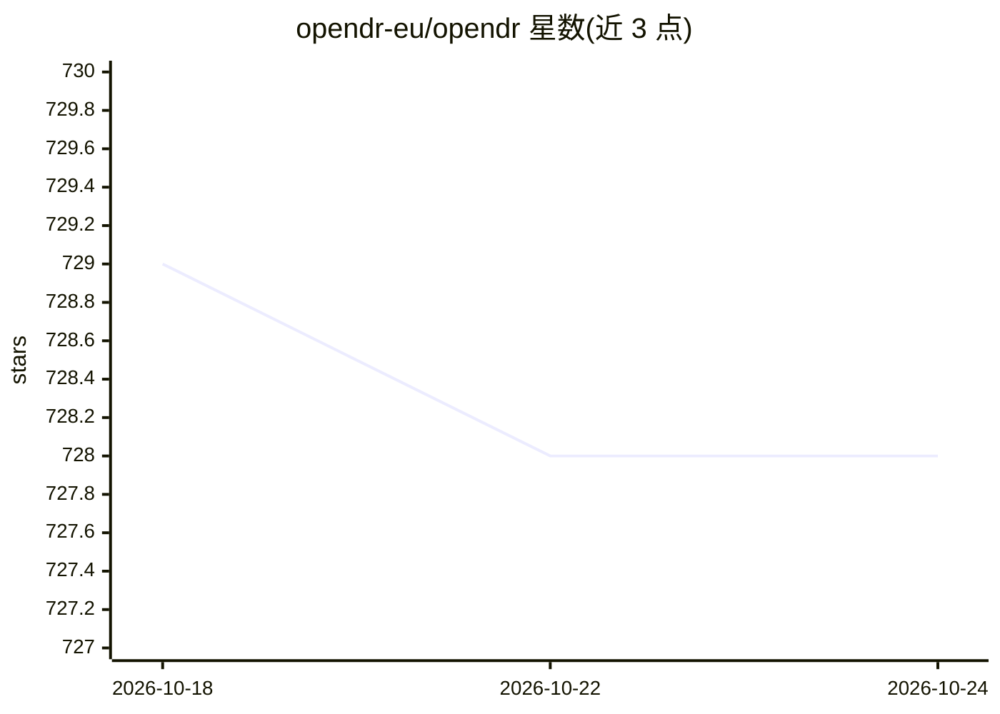

# opendr-eu/opendr

⭐ 728 · Python · Apache-2.0 · 推送 2026-05-11 · [GitHub](https://github.com/opendr-eu/opendr) · 组织维护

**面向机器人的深度学习工具包：感知/认知/决策工具与 ROS 接口**

欧盟 OpenDR 项目开发的模块化开源机器人工具包，用深度学习提供感知与认知能力，面向医疗、农食与敏捷生产场景的机器人应用。提供 Python 接口、性能关键场景的 C API、ROS1/ROS2 接口与现成 ROS 节点；包含感知、控制、仿真与超参数调优的示例。支持 PyTorch/TensorFlow 深度学习框架，遵循 ONNX 模型格式与 OpenAI Gym 接口，兼容 Webots 机器人仿真器。可通过源码克隆、pip（仅 CPU/GPU 版）或 Docker 安装。

## 筛选速览

| 维度 | 判定 | 备注 |
|---|---|---|
| AI 角色 | `ai-native` | 本体是模型或模型工具 |
| 许可风险 | `permissive` | Apache-2.0 |
| 部署形态 | `None` |  |
| 模型依赖 | — | README 未给出锁定关系 |
| 硬件要求 | — | 无带数字的原话,不猜 |
| 安装摩擦 | `low` | 无编译、无系统依赖或容器化 |
| 成熟度 | — | 结构信号不足 |

## 能力要点

- 深度学习工具覆盖人机环境感知、训练与推理、认知决策
- 提供 Python 接口、C API 与 ROS1/ROS2 接口及现成 ROS 节点
- 遵循 ONNX 模型格式与 OpenAI Gym 接口，支持 Webots 仿真器
- 支持 pip、Docker、源码克隆三种安装方式（CPU/GPU）

## 适用场景

- 为机器人系统添加基于深度学习的感知与认知能力
- 通过 ROS1/ROS2 节点在机器人操作环境中部署 AI 工具
- 复用感知、控制、仿真与调优示例开展机器人研究

## 场景标签

`目标检测` `人脸识别` · 领域:感知与多模态

## 证据(README 行号)

> L23: The aim of OpenDR Project is to develop a **modular, open** and **non-proprietary toolkit** for core **robotic func
> L27: 2. **learn and categorize** by developing deep learning **tools for training and inference in common robotics setti
> L43: OpenDR provides an intuitive and easy to use **Python interface**, a **C API for performance critical application**

## 星数曲线

2026-10-18 729 → 2026-10-24 728（-1）

---
*卡片 v1 · prompt 1.4 · 生成 2026-10-21 · 置信度 high · 依据 README sha `fbc875b7073c` · [字段定义](../../DATASET.md)*
