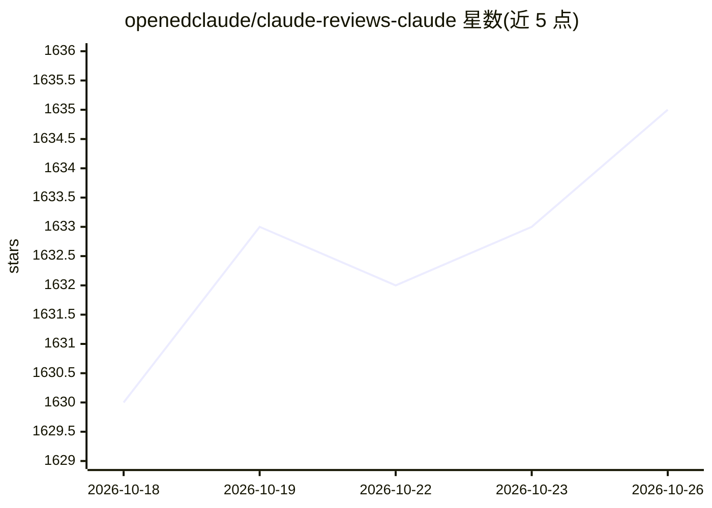

# openedclaude/claude-reviews-claude

⭐ 1,635 · MIT · 推送 2026-04-01 · [GitHub](https://github.com/openedclaude/claude-reviews-claude) · [官网](https://openedclaude.github.io/claude-reviews-claude/) · 个人维护 · 中文 README

**Claude 撰写的 Claude Code v2.1.88 架构深度解析文档（17 章，中英双语）**

由 Claude 阅读并分析 Claude Code v2.1.88 的 TypeScript 源码（1,902 个文件、47.7 万行）后撰写的结构化架构分析文档，共 17 章，覆盖查询引擎、42+ 工具系统、多智能体协调、插件/钩子系统、权限流水线、上下文压缩等 17 个子系统，含架构图与代码走读。面向想理解 Claude Code 内部实现的开发者与研究者。文档以 MIT 许可发布，部署于 GitHub Pages 支持全文搜索，另列出两个社区还原源码仓库供参考。

## 筛选速览

| 维度 | 判定 | 备注 |
|---|---|---|
| AI 角色 | `ai-knowledge` | 知识聚合/清单类 |
| 许可风险 | `permissive` | MIT |
| 部署形态 | `None` |  |
| 模型依赖 | — | README 未给出锁定关系 |
| 硬件要求 | — | 无带数字的原话,不猜 |
| 安装摩擦 | `low` | 无编译、无系统依赖或容器化 |
| 成熟度 | — | 结构信号不足 |

## 能力要点

- 17 章覆盖 Claude Code 的 17 个子系统，含架构图与代码走读
- 分析对象为 v2.1.88：1,902 个文件、477,439 行 TypeScript 源码
- 全 18 篇中英双语对照，GitHub Pages 在线阅读支持搜索与暗色模式
- 引用社区还原源码仓库（instructkr/claw-code、ChinaSiro/claude-code-sourcemap）

## 适用场景

- 学习 Claude Code 的查询引擎与工具循环架构
- 研究多智能体协调与上下文压缩等子系统设计
- 按章节导航系统性阅读大型 Agent CLI 的实现

## 场景标签

`教程课程` · 领域:学习与行业

## 证据(README 行号)

> L21: > **这份完整的架构分析是由 Claude 撰写的**
> L31: 这**绝非**简单的源代码归档。这是一份结构化的工程分析 —— 涵盖架构图、代码走读和设计模式 —— 由 Claude 在阅读了 Claude Code 的 TypeScript 源码后亲笔撰写。
> L113: **架构解析系列** (全 17 篇 —— 已完结 ✅)

## 星数曲线

2026-10-18 1,630 → 2026-10-26 1,635（+5）

---
*卡片 v1 · prompt 1.4 · 生成 2026-10-21 · 置信度 high · 依据 README sha `8fe4f1a4b317` · [字段定义](../../DATASET.md)*
