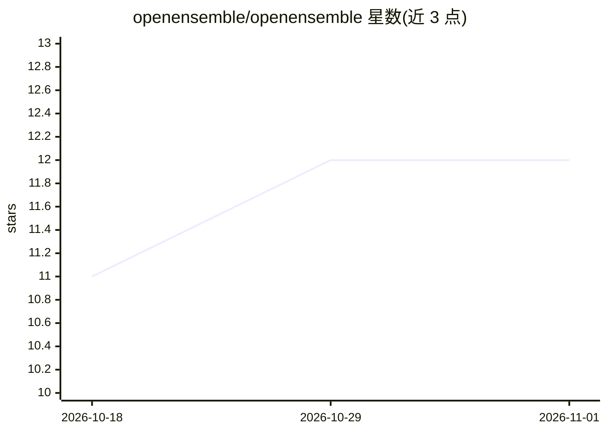

# openensemble/openensemble

⭐ 12 · JavaScript · AGPL-3.0 · 推送 2026-10-30 · [GitHub](https://github.com/openensemble/openensemble) · [官网](https://openensemble.github.io/openensemble/) · 组织维护

**自托管多用户 AI 助手：本地/云模型、Agent、仪表盘与语音设备**

可自行部署的多用户 AI 助手平台：每个用户独立工作区，先建单一助手，后续可切换为多专家 Agent 集群（Cortex 提供内部推理与检索，聊天仍依赖外部 provider）。支持接入 Claude、OpenAI、Ollama、LM Studio 等本地或云端模型，并集成邮件、日历、Home Assistant、任务调度、文件与代码项目、MCP 技能。每个配置最多 32 个仪表盘，可配 ESP32 语音卫星设备（beta，含预编译固件）。主安装路径为 Debian 系 Linux + Node.js 22.12+，通过 install.sh 一键安装，提供备份恢复与 systemd 服务。

## 筛选速览

| 维度 | 判定 | 备注 |
|---|---|---|
| AI 角色 | `ai-native` | 本体是模型或模型工具 |
| 许可风险 | `viral` | AGPL-3.0 |
| 部署形态 | `self-host` | docker 或自建部署 |
| 模型依赖 | — | README 未给出锁定关系 |
| 硬件要求 | — | 无带数字的原话,不猜 |
| 安装摩擦 | `low` | 无编译、无系统依赖或容器化 |
| 成熟度 | `idea` | |

## 能力要点

- 单一助手与多专家 Agent 集群模式可切换
- 接入本地/云模型（Ollama、LM Studio、Claude、OpenAI 等）
- 每配置最多 32 个仪表盘，聚合 Home Assistant、日历、邮件等组件
- ESP32 语音卫星设备（beta）：唤醒词、对话模式、AirPlay

## 适用场景

- 在家庭或小团队服务器上搭建各自独立的 AI 助手工作区
- 把 AI 助手与邮件、日历、智能家居设备联动并做成平板仪表盘
- 配置本地模型与本地语音处理实现私有化部署

## 场景标签

`AI 助手` `语音 Agent` · 领域:对话与助手

## 证据(README 行号)

> L3: A self-hosted AI assistant with your choice of local or cloud models. Start
> L21: 4. Open **Settings → Providers**, connect one chat provider, and enable it.
> L24: New accounts use **Single assistant** mode. To add specialists later, switch

## 星数曲线

2026-10-18 11 → 2026-11-01 12（+1）

---
*卡片 v1 · prompt 1.4 · 生成 2026-11-01 · 置信度 mid · 依据 README sha `03bb77d7bc21` · [字段定义](../../DATASET.md)*
