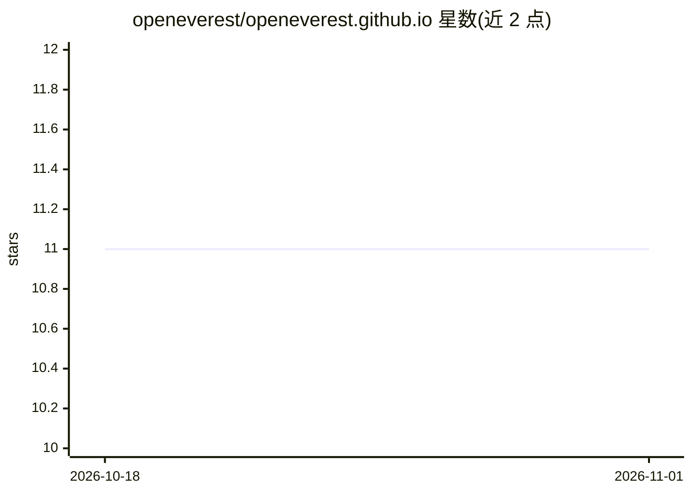

# openeverest/openeverest.github.io

⭐ 11 · HTML · Apache-2.0 · 推送 2026-10-30 · [GitHub](https://github.com/openeverest/openeverest.github.io) · [官网](https://openeverest.io/) · 组织维护

**OpenEverest 项目官方网站（Hugo 静态站点）源码仓库**

openereverest.io 官网的源码仓库：OpenEverest 自称首个开源的数据库自动化供给与管理平台，本仓库仅承载其官网与博客内容。站点基于 Hugo v0.147.3 (Extended)、Node.js v20 与 Tailwind CSS v4 构建，支持 npm run dev 本地实时预览、npm run build 产出静态文件到 public/ 目录，并通过 Fork + PR 流程接受博客与代码贡献。注意：仓库内容为网站本身，不含数据库平台的实现代码。

## 筛选速览

| 维度 | 判定 | 备注 |
|---|---|---|
| AI 角色 | `ai-knowledge` | 知识聚合/清单类 |
| 许可风险 | `permissive` | Apache-2.0 |
| 部署形态 | `library` | 以包/库形式分发 |
| 模型依赖 | — | README 未给出锁定关系 |
| 硬件要求 | — | 无带数字的原话,不猜 |
| 安装摩擦 | `low` | 无编译、无系统依赖或容器化 |
| 成熟度 | — | 结构信号不足 |

## 能力要点

- Hugo + Node.js v20 + Tailwind CSS v4 构建的静态站点
- npm run dev 本地开发服务器（localhost:5000，实时刷新）
- npm run build 生成静态站点到 public/ 目录
- 支持通过 PR 投稿博客（content/blog/ 目录）

## 适用场景

- 本地预览或修改 OpenEverest 官网内容
- 为 OpenEverest 官网撰写并提交博客文章
- 了解 OpenEverest 项目的对外文档入口

## 场景标签

 · 领域:开发者工具/数据库（官网）

## 证据(README 行号)

> L3: This is the official website for openeverest.io - the OpenEverest project. OpenEverest is the first open-source plat
> L7: - **Hugo v0.147.3** (Extended) - Static site generator

## 星数曲线

2026-10-18 11 → 2026-11-01 11（+0）

---
*卡片 v1 · prompt 1.4 · 生成 2026-11-01 · 置信度 mid · 依据 README sha `7ec60c6ab66f` · [字段定义](../../DATASET.md)*
