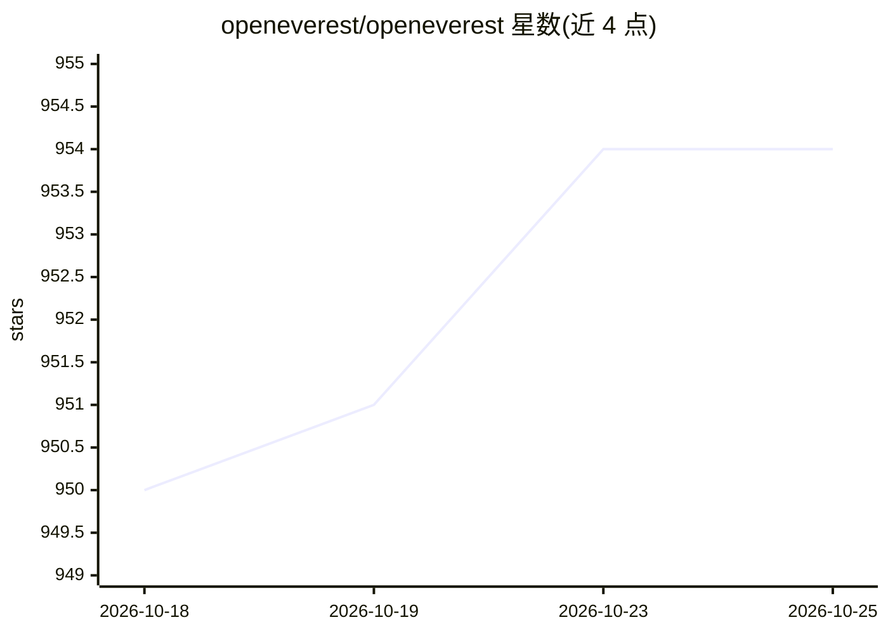

# openeverest/openeverest

⭐ 954 · TypeScript · Apache-2.0 · 推送 2026-10-23 · [GitHub](https://github.com/openeverest/openeverest) · [官网](https://openeverest.io/) · 组织维护

**在 Kubernetes 上自动化部署管理数据库、存储与 LLM 的开源平台**

开源云原生数据库平台，供开发者以少量点击在 Kubernetes（云端或本地）上部署数据库实例、存储与 LLM，并提供扩展、监控、备份自动化与数据安全管理能力。提供 Helm Chart 安装（推荐）与 everestctl CLI 安装两种方式，CLI 支持 Linux/WSL 与 macOS（Apple Silicon/Intel）二进制下载，附带向导与 headless 模式。当前 main 分支为 v2 Developer Preview（未功能完整、不适用于生产），v1 仍在 v1.x 分支继续发布。

## 筛选速览

| 维度 | 判定 | 备注 |
|---|---|---|
| AI 角色 | `ai-ecosystem` | LLM/agent 周边工具 |
| 许可风险 | `permissive` | Apache-2.0 |
| 部署形态 | `library` | 以包/库形式分发 |
| 模型依赖 | — | README 未给出锁定关系 |
| 硬件要求 | — | 无带数字的原话,不猜 |
| 安装摩擦 | `low` | 无编译、无系统依赖或容器化 |
| 成熟度 | `idea` | |

## 能力要点

- Helm Chart 安装与 everestctl CLI（向导/headless 两种模式）
- 支持 MongoDB/PostgreSQL/MySQL 等 operator 的数据库部署管理
- 可在任意 Kubernetes 基础设施上运行（云上或本地）

## 适用场景

- 在自有 Kubernetes 集群上自助开通和管理数据库实例
- 团队统一管理数据库备份、监控与扩展
- 降低 DBaaS 成本并收回数据与配置控制权

## 场景标签

 · 领域:云原生/数据库基础设施

## 证据(README 行号)

> L22: OpenEverest is an open source cloud-native database platform that helps developers deploy code faster, scale deploy
> L42: ## Install OpenEverest Using Helm (Recommended)

## 星数曲线

2026-10-18 950 → 2026-10-25 954（+4）

---
*卡片 v1 · prompt 1.4 · 生成 2026-10-21 · 置信度 mid · 依据 README sha `07aefc829102` · [字段定义](../../DATASET.md)*
