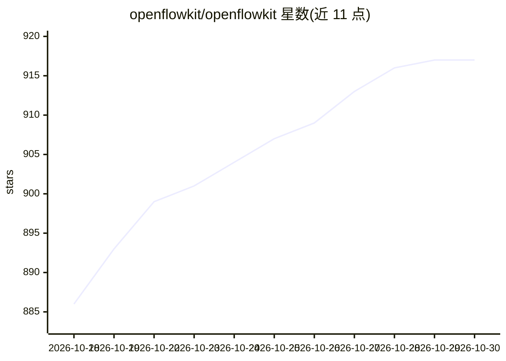

# openflowkit/openflowkit

⭐ 917 · TypeScript · MIT · 推送 2026-10-22 · [GitHub](https://github.com/openflowkit/openflowkit) · [官网](https://openflowkit.com/) · 组织维护

**开源架构图绘制画布：画图、代码写图、AI agent 代画**

免费 MIT 许可、本地优先的图表画布应用，支持以自有 DSL 文本绘图并在文本与画布间双向同步，可导入 Mermaid、Structurizr、D2 并转换，覆盖 10 种图类型。支持粘贴 GitHub 仓库名自动生成架构图，每条连线标注 file:line 出处。通过 MCP 服务器（29 个工具）接入 Claude Code、Cursor 等 agent 在画布上实时绘图；内置可选 AI 助手（自带 key，支持多家模型端点）。提供浏览器版、npm CLI（render/validate/discover/drift）、GitHub Action 与插件安装。

## 筛选速览

| 维度 | 判定 | 备注 |
|---|---|---|
| AI 角色 | `ai-enhanced` | 去掉 AI 部分产品仍成立 |
| 许可风险 | `permissive` | MIT |
| 部署形态 | `self-host` | docker 或自建部署 |
| 模型依赖 | local-ok | 支持本地模型 |
| 硬件要求 | — | 无带数字的原话,不猜 |
| 安装摩擦 | `low` | 无编译、无系统依赖或容器化 |
| 成熟度 | — | 结构信号不足 |

## 能力要点

- 文本与画布同一文档，双向同步且每次改动单步可撤销
- 粘贴 GitHub 仓库生成架构图，每条箭头标注 file:line 出处
- MCP 服务器提供 29 个工具，agent 可绘图、截图自查、分析代码库
- 支持 Mermaid/Structurizr/D2 导入转换，导出 PNG/SVG/PDF/动画

## 适用场景

- 把已有 Mermaid 图转成可编辑画布或反向导出到 README
- 让 Claude Code 等 agent 根据代码库代我绘制和修改架构图
- 在 CI 中用 drift 命令检测架构图与代码的偏差

## 场景标签

 · 领域:开发者工具/图表绘制

## 证据(README 行号)

> L5:  Architecture diagrams you draw, write as code, or hand to your agent.
> L33: Connect Claude Code, Cursor or any MCP client and ask for a diagram. The agent reads the page,
> L109: **In the browser:** app.openflowkit.com. Nothing to install, no account.

## 星数曲线

2026-10-18 886 → 2026-10-30 917（+31）

---
*卡片 v1 · prompt 1.4 · 生成 2026-10-21 · 置信度 mid · 依据 README sha `7e3ddd72def8` · [字段定义](../../DATASET.md)*
