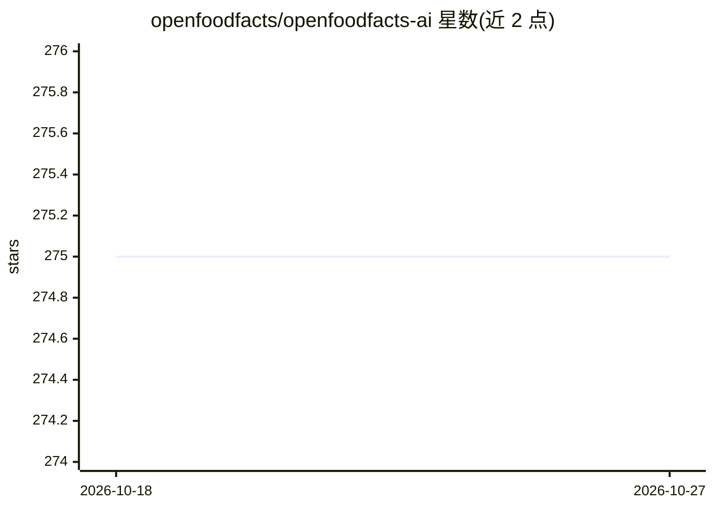

# openfoodfacts/openfoodfacts-ai

⭐ 275 · Python · 推送 2026-10-26 · [GitHub](https://github.com/openfoodfacts/openfoodfacts-ai) · 组织维护

**Open Food Facts 的 AI 实验追踪仓库：记录模型训练与项目清单**

用于追踪和存放 Open Food Facts 社区在食品数据上的实验性 AI 项目、模型训练与愿望清单，涵盖营养表检测与提取、类别预测（含 Google.org fellowship 项目）、标签与 Logo 检测、拼写检查等方向。已训练模型与数据集附在本仓库或 robotoff-models 的 releases 中，生产集成则进入 Robotoff 仓库。面向贡献者提供周会安排、贡献指南与研究课题建议。

## 筛选速览

| 维度 | 判定 | 备注 |
|---|---|---|
| AI 角色 | `ai-knowledge` | 知识聚合/清单类 |
| 许可风险 | `none` | — |
| 部署形态 | `None` |  |
| 模型依赖 | — | README 未给出锁定关系 |
| 硬件要求 | — | 无带数字的原话,不猜 |
| 安装摩擦 | `low` | 无编译、无系统依赖或容器化 |
| 成熟度 | — | 结构信号不足 |

## 能力要点

- 收录营养表检测、类别预测、Logo 检测、拼写检查等多类实验项目及其部署状态
- 训练好的模型与数据集附于本仓库及 robotoff-models 的 releases
- 每周二召开线上会议并有公开议程记录
- 贡献者可 fork 仓库开展自有实验，需使用 AGPL 或兼容的更宽松许可

## 适用场景

- 查找 Open Food Facts 食品图像与文本数据的 AI 研究方向
- 获取已训练模型与数据集用于食品类别预测或营养表提取
- 参与开源食品数据社区的 AI 项目贡献

## 场景标签

`模型训练` `目标检测` `精选清单` · 领域:学习与行业

## 证据(README 行号)

> L12: * This repository is to track and store all our experimental AI endeavours, models training, and wishlists.
> L22: ## 🔬 Projects

## 星数曲线

2026-10-18 275 → 2026-10-27 275（+0）

---
*卡片 v1 · prompt 1.4 · 生成 2026-10-22 · 置信度 mid · 依据 README sha `09d5e1546b64` · [字段定义](../../DATASET.md)*
