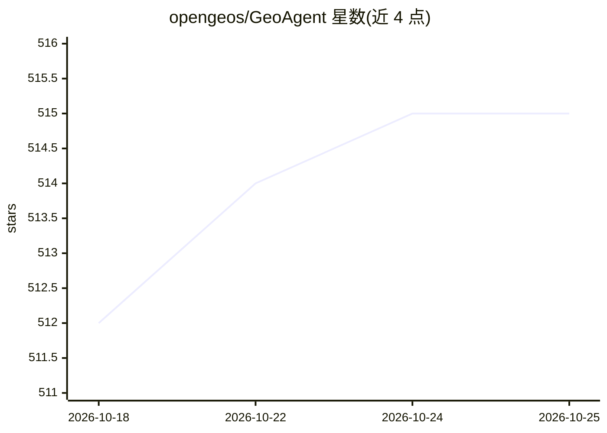

# opengeos/GeoAgent

⭐ 515 · Python · MIT · 推送 2026-10-25 · [GitHub](https://github.com/opengeos/GeoAgent) · [官网](https://geoagent.gishub.org) · 个人维护

**给地理空间库与 QGIS 提供共享 AI agent 层，统一接入 LLM**

基于 Strands Agents 构建的 Python 框架，为 leafmap、anymap、geoai、geemap、STAC、NASA Earthdata 等地理空间包及 QGIS 插件提供统一的 agent 接入层：将包函数注册为带元数据的结构化工具，绑定到地图部件或 QGIS 会话，支持 OpenAI、Anthropic、Gemini、Bedrock、OpenRouter、LiteLLM、vLLM 与本地 Ollama 等多种模型来源，并提供执行前确认钩子与 Solara 浏览器 UI、MapLibre WebSocket 后端及 QGIS 停靠聊天插件。核心仅安装 strands-agents 与 pydantic，地理空间栈与各 provider 客户端均为可选 extras；QGIS 本体需系统安装。

## 筛选速览

| 维度 | 判定 | 备注 |
|---|---|---|
| AI 角色 | `ai-ecosystem` | LLM/agent 周边工具 |
| 许可风险 | `permissive` | MIT |
| 部署形态 | `library` | 以包/库形式分发 |
| 模型依赖 | local-ok | 支持本地模型 |
| 硬件要求 | — | 无带数字的原话,不猜 |
| 安装摩擦 | `low` | 无编译、无系统依赖或容器化 |
| 成熟度 | — | 结构信号不足 |

## 能力要点

- @geo_tool 装饰器与工具注册表，将 Python 函数转为带安全标记的结构化工具
- 支持 OpenAI/Anthropic/Gemini/Bedrock/OpenRouter/LiteLLM/vLLM/Ollama 等多种 provider
- 删除图层、保存文件等操作前的确认钩子（默认拒绝，可开启自动批准）
- 提供 QGIS 插件、Solara UI 与浏览器 MapLibre WebSocket 多种交互界面

## 适用场景

- 在 QGIS 中用自然语言检查图层、加载数据与执行处理流程
- 为 leafmap/anymap 地图绑定对话式 agent 操作地图
- 地理空间库维护者复用该层而无需自建 agent 框架
- 通过 OpenRouter 使用 DeepSeek、Qwen 等模型做地理分析

## 场景标签

`Agent 框架` · 领域:Agent 开发

## 证据(README 行号)

> L16: **GeoAgent** is a shared AI agent layer for geospatial Python packages, live
> L22: Built on **Strands Agents**, GeoAgent adds
> L50: GeoAgent centralizes that layer so each package does not need to maintain its

## 星数曲线

2026-10-18 512 → 2026-10-25 515（+3）

---
*卡片 v1 · prompt 1.4 · 生成 2026-10-21 · 置信度 high · 依据 README sha `ad9017a1e648` · [字段定义](../../DATASET.md)*
