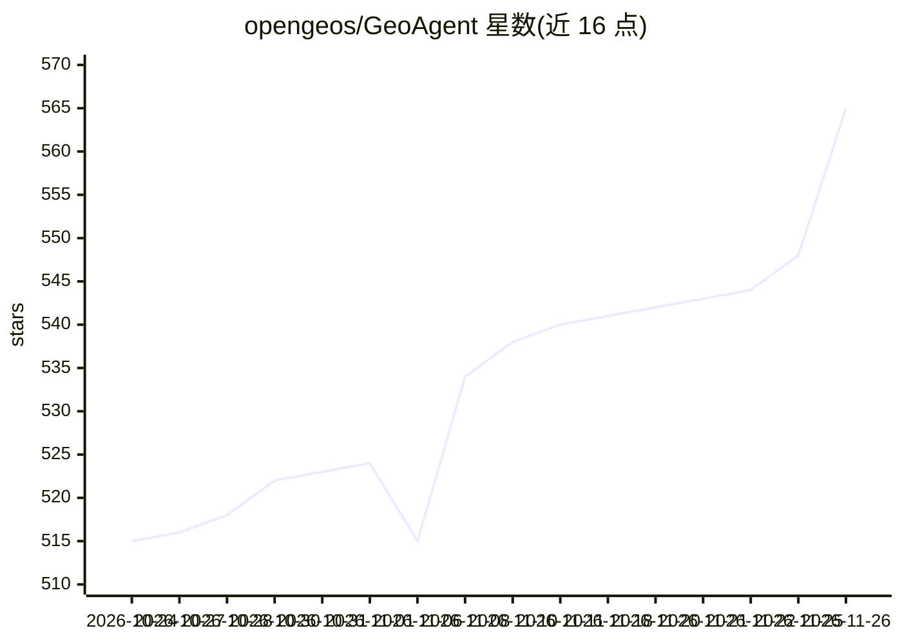

# opengeos/GeoAgent

⭐ 565 · Python · MIT · 推送 2026-11-23 · [GitHub](https://github.com/opengeos/GeoAgent) · [官网](https://geoagent.gishub.org) · 组织维护

**为地理空间 Python 库与 QGIS 提供统一 LLM agent 接入层**

基于 Strands Agents 构建的共享 agent 层，让 leafmap、anymap、geoai、geemap、STAC、NASA Earthdata 等地理空间包通过统一接口向大语言模型暴露工具，各库无需自建 agent 栈。核心机制包括：@geo_tool 装饰器将 Python 函数转为带元数据的工具、GeoToolRegistry 管理工具元数据与安全标记、for_leafmap/for_qgis/for_stac 等工厂将 agent 绑定到地图或 QGIS 会话；在删除图层、保存文件等不可逆操作前触发确认钩子。核心包仅含 agent 框架依赖，地理空间栈与 provider 客户端均为可选 extras；QGIS 本体需由桌面应用或系统包管理器另行安装。

## 筛选速览

| 维度 | 判定 | 备注 |
|---|---|---|
| AI 角色 | `ai-ecosystem` | LLM/agent 周边工具 |
| 许可风险 | `permissive` | MIT |
| 部署形态 | `library` | 以包/库形式分发 |
| 模型依赖 | local-ok | 支持本地模型 |
| 硬件要求 | — | 无带数字的原话,不猜 |
| 安装摩擦 | `low` | 无编译、无系统依赖或容器化 |
| 成熟度 | — | 结构信号不足 |

## 能力要点

- 统一接口为多个地理空间库暴露 LLM 工具，基于 Strands Agents
- 支持 OpenAI、Anthropic、Gemini、Bedrock、OpenRouter、LiteLLM、vLLM、本地 Ollama 等多种 provider
- @geo_tool 装饰器与 GeoToolRegistry 提供结构化工具元数据与安全标记
- 破坏性或昂贵操作前的确认钩子，Solara UI 默认拒绝需确认的工具

## 适用场景

- 在 Jupyter 中用自然语言操作 leafmap 地图与图层
- 在 QGIS 内通过聊天面板执行地理空间分析与可视化
- 搜索并加载 STAC 目录与 NASA OPERA 数据
- 为自研地理空间包接入现成的 agent 工具层

## 场景标签

`Agent 框架` · 领域:Agent 开发

## 证据(README 行号)

> L16: **GeoAgent** is a shared AI agent layer for geospatial Python packages, live
> L22: Built on **Strands Agents**, GeoAgent adds
> L50: GeoAgent centralizes that layer so each package does not need to maintain its

## 星数曲线

2026-10-24 515 → 2026-11-26 565（+50）

---
*卡片 v1 · prompt 1.4 · 生成 2026-11-25 · 置信度 high · 依据 README sha `d1e897861a27` · [字段定义](../../DATASET.md)*
