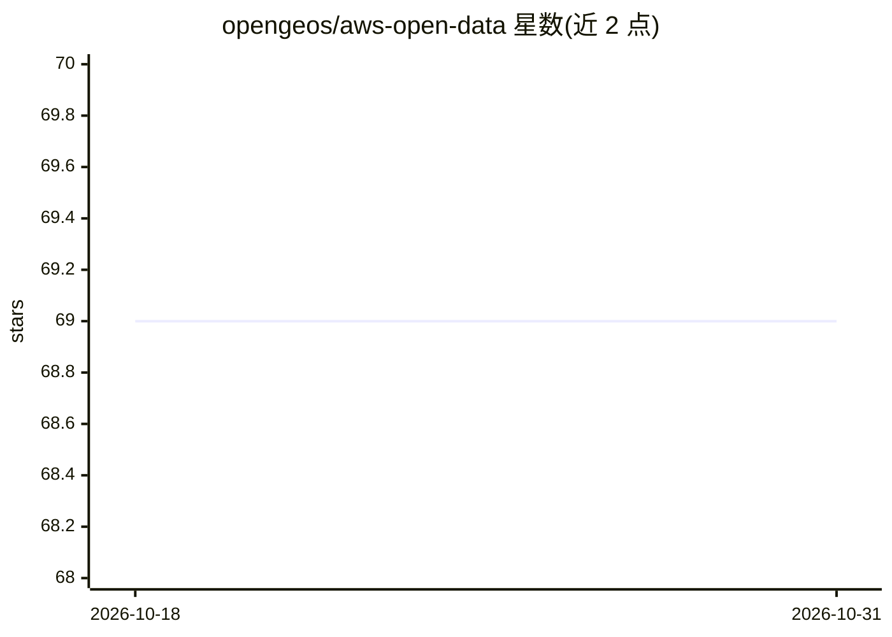

# opengeos/aws-open-data

⭐ 69 · Python · MIT · 推送 2026-10-30 · [GitHub](https://github.com/opengeos/aws-open-data) · 个人维护

**AWS 开放数据集清单：以 TSV/JSON 形式每日更新的数据集目录**

汇总 AWS Open Data 计划托管的公开数据集，编译为 TSV 与 JSON 两种格式文件，每日更新，便于通过程序（如 Pandas）查找与使用。README 给出读取 TSV 到 DataFrame 的代码示例，并列出多个相关项目：AWS 地理空间数据集清单、带 STAC 端点的清单、Microsoft Planetary Computer、Google Earth Engine、NASA CMR 等数据目录索引。

## 筛选速览

| 维度 | 判定 | 备注 |
|---|---|---|
| AI 角色 | `ai-knowledge` | 知识聚合/清单类 |
| 许可风险 | `permissive` | MIT |
| 部署形态 | `None` |  |
| 模型依赖 | — | README 未给出锁定关系 |
| 硬件要求 | — | 无带数字的原话,不猜 |
| 安装摩擦 | `low` | 无编译、无系统依赖或容器化 |
| 成熟度 | — | 结构信号不足 |

## 能力要点

- 以 TSV 与 JSON 文件形式提供 AWS 开放数据集清单
- 列表每日更新
- 提供 Pandas 读取示例代码
- 关联多个地理空间数据目录项目（STAC/Planetary Computer/GEE/NASA CMR）

## 适用场景

- 程序化获取 AWS 开放数据集的完整清单
- 查找可用的公开数据集用于数据科学或机器学习项目
- 浏览地理空间相关开放数据目录入口

## 场景标签

`精选清单` · 领域:学习与行业

## 证据(README 行号)

> L9: The AWS Open Data program hosts a lot of publicly available datasets. This repo compiles the list of all datasets on

## 星数曲线

2026-10-18 69 → 2026-10-31 69（+0）

---
*卡片 v1 · prompt 1.4 · 生成 2026-10-24 · 置信度 high · 依据 README sha `a519ab6d06de` · [字段定义](../../DATASET.md)*
