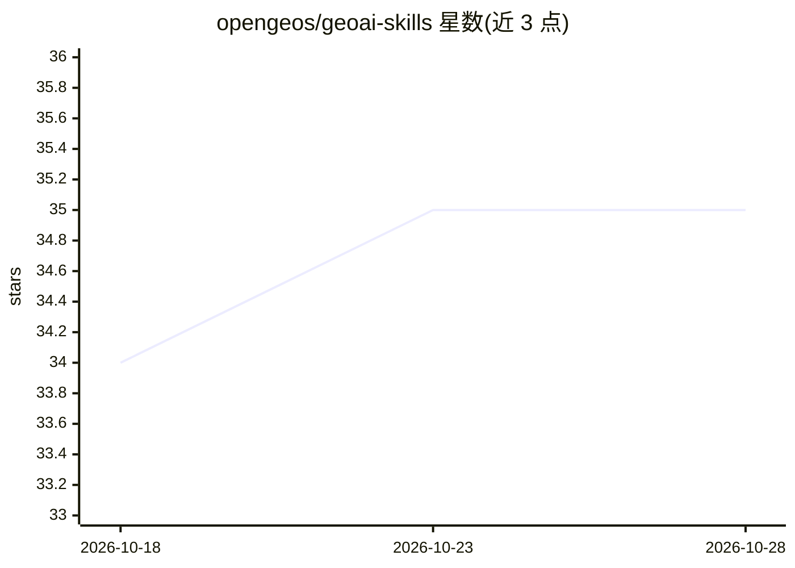

# opengeos/geoai-skills

⭐ 35 · MIT · 推送 2026-10-12 · [GitHub](https://github.com/opengeos/geoai-skills) · 个人维护

**给 Claude Code 加地理空间 AI 技能的插件：探查、下载、检测影像**

基于 GeoAI Python 库构建的 Claude Code 插件，提供九个斜杠命令技能：检视栅格/矢量文件元数据、下载 NAIP 航拍影像、从 Microsoft Planetary Computer 检索卫星影像、下载 Overture Maps 数据、栅格处理、用预训练模型检测建筑物/车辆/船舶/太阳能板（含 GroundedSAM 文本提示分割）、搜索历史会话记录、校验依赖。技能间通过项目级 state.json 共享状态以自动填充路径。需 Python 3.10+ 与 geoai-py 包；深度学习可选 CUDA（CPU 可运行）；已在 macOS/Linux 测试，Windows 未完全支持。

## 筛选速览

| 维度 | 判定 | 备注 |
|---|---|---|
| AI 角色 | `ai-ecosystem` | LLM/agent 周边工具 |
| 许可风险 | `permissive` | MIT |
| 部署形态 | `library` | 以包/库形式分发 |
| 模型依赖 | locked-api |  |
| 硬件要求 | — | 无带数字的原话,不猜 |
| 安装摩擦 | `low` | 无编译、无系统依赖或容器化 |
| 成熟度 | `idea` | |

## 能力要点

- 运行预训练模型检测建筑物、车辆、船舶、太阳能板，支持 GroundedSAM 文本提示分割
- NAIP 航拍影像与 Overture Maps 数据按边界框下载
- STAC 目录检索并下载 Microsoft Planetary Computer 卫星影像
- 项目级 state.json 跨技能共享文件路径等状态

## 适用场景

- 在 Claude Code 中一站式完成遥感影像下载、检视与 AI 目标检测
- 为地理空间分析工作流恢复过往会话中的决策与数据路径上下文
- 按边界框获取 Overture Maps 建筑物、道路等矢量数据

## 场景标签

`目标检测` `图像视频处理` · 领域:感知与多模态

## 证据(README 行号)

> L3: A Claude Code plugin that adds GeoAI-powered skills for geospatial data exploration, satellite imagery download, AI-
> L88: Run pre-trained AI models on geospatial imagery. Detect buildings, cars, ships, solar panels, or use text-prompted 

## 星数曲线

2026-10-18 34 → 2026-10-28 35（+1）

---
*卡片 v1 · prompt 1.4 · 生成 2026-10-25 · 置信度 mid · 依据 README sha `ff77adc7e44c` · [字段定义](../../DATASET.md)*
