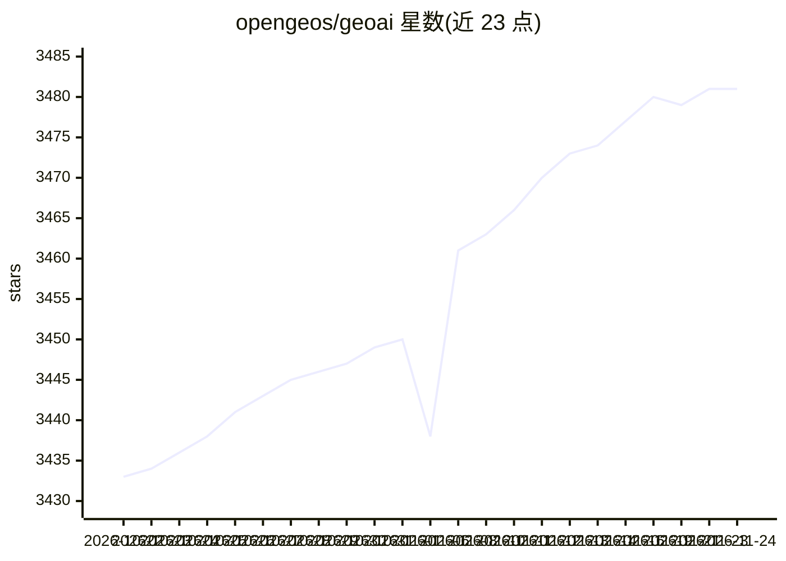

# opengeos/geoai

⭐ 3,488 · Python · MIT · 推送 2026-11-23 · [GitHub](https://github.com/opengeos/geoai) · [官网](https://opengeoai.org) · 个人维护

**面向地理空间研究者的 AI 遥感分析 Python 包**

GeoAI 是一个将 AI 与地理空间数据分析结合的 Python 包，提供卫星影像/航空影像/矢量数据的处理框架，覆盖数据检索下载、训练数据制备、分类/检测/分割模型训练、推理管线与交互式可视化六项核心能力，底层集成 PyTorch、Transformers、PyTorch Segmentation Models 等框架。支持 GeoTIFF 等多种格式，GPU 可用时自动管理设备加速；通过专用 QGIS 插件可在桌面端无代码运行 AI 工作流。附配套书籍与视频教程，MIT 许可开源。

## 筛选速览

| 维度 | 判定 | 备注 |
|---|---|---|
| AI 角色 | `ai-native` | 本体是模型或模型工具 |
| 许可风险 | `permissive` | MIT |
| 部署形态 | `library` | 以包/库形式分发 |
| 模型依赖 | — | README 未给出锁定关系 |
| 硬件要求 | — | 无带数字的原话,不猜 |
| 安装摩擦 | `low` | 无编译、无系统依赖或容器化 |
| 成熟度 | — | 结构信号不足 |

## 能力要点

- 六项核心能力：影像检索下载、数据集制备、模型训练、推理、可视化、QGIS 插件
- 收录 20 个遥感基础模型的目录，可按类别/模态/任务过滤并直接加载 TerraTorch 支持的骨干
- 支持 GeoTIFF、GeoJSON、Shapefile、GeoPackage 等多种数据格式
- GPU 可用时自动设备管理加速

## 适用场景

- 从卫星影像提取建筑物轮廓、土地覆盖分类与变化检测
- 自动生成影像切片与标注的训练数据集
- 在 QGIS 桌面环境无代码运行 AI 地理分析工作流
- 检索与浏览遥感基础模型目录用于下游任务

## 场景标签

`目标检测` `模型训练` `数据分析` · 领域:效率与自动化

## 证据(README 行号)

> L19: GeoAI is a comprehensive Python package designed to bridge artificial intelligence (AI) and geospatial data analysi
> L25: 3. Model training for tasks such as classification, detection, and segmentation.
> L28: 6. Seamless QGIS integration via a dedicated GeoAI plugin, enabling users to run AI-powered geospatial workflows di

## 星数曲线

2026-10-22 3,433 → 2026-11-24 3,481（+48）

---
*卡片 v1 · prompt 1.4 · 生成 2026-11-23 · 置信度 high · 依据 README sha `3b8541e440f5` · [字段定义](../../DATASET.md)*
