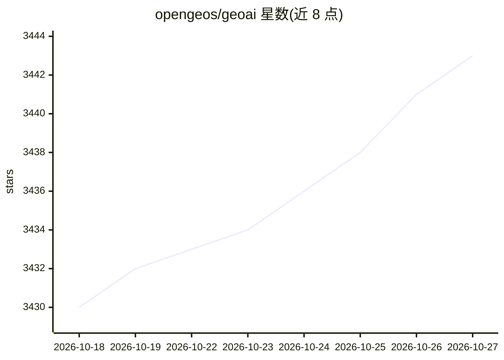

# opengeos/geoai

⭐ 3,443 · Python · MIT · 推送 2026-10-26 · [GitHub](https://github.com/opengeos/geoai) · [官网](https://opengeoai.org) · 个人维护

**将深度学习应用于地理空间数据的 Python 工具包**

面向地理空间研究者、AI 从业者与教学场景的 Python 包，统一封装数据获取与预处理、训练样本自动生成（图像切片与标签）、分类/检测/分割模型训练与推理、交互式可视化（Leafmap/MapLibre），并通过专用插件在 QGIS 桌面环境内无代码运行 AI 工作流。底层集成 PyTorch、Transformers、PyTorch Segmentation Models 及 torchange 等库；内置 20 个遥感基础模型目录，可按类别/模态/任务筛选并加载 TerraTorch 支持的骨干网络。支持 GPU 加速的自动设备管理，提供 pip/conda/mamba 安装与配套书籍。

## 筛选速览

| 维度 | 判定 | 备注 |
|---|---|---|
| AI 角色 | `ai-native` | 本体是模型或模型工具 |
| 许可风险 | `permissive` | MIT |
| 部署形态 | `library` | 以包/库形式分发 |
| 模型依赖 | — | README 未给出锁定关系 |
| 硬件要求 | — | 无带数字的原话,不猜 |
| 安装摩擦 | `low` | 无编译、无系统依赖或容器化 |
| 成熟度 | — | 结构信号不足 |

## 能力要点

- 六项核心能力：数据搜索下载、训练集生成、模型训练、推理、可视化、QGIS 插件
- 内置 20 个遥感基础模型目录，支持按类别/模态/任务筛选与元数据查询
- 支持 GeoTIFF/GeoJSON/Shapefile/GeoPackage 等多种格式与 GPU 自动设备管理
- 提供配套书籍、文档、教程视频与示例 notebook

## 适用场景

- 从卫星影像提取建筑足迹、水体、太阳能板等地物并导出为矢量格式
- 对土地覆盖/土地利用做分类与多时相变化检测
- 微调预训练遥感模型并用自有数据做迁移学习
- 在 QGIS 中不写代码运行 AI 地理空间工作流

## 场景标签

`目标检测` `微调` `教程课程` · 领域:学习与行业

## 证据(README 行号)

> L25: 3. Model training for tasks such as classification, detection, and segmentation.
> L26: 4. Inference pipelines for applying models to new geospatial datasets.

## 星数曲线

2026-10-18 3,430 → 2026-10-27 3,443（+13）

---
*卡片 v1 · prompt 1.4 · 生成 2026-10-21 · 置信度 high · 依据 README sha `c332699c422c` · [字段定义](../../DATASET.md)*
