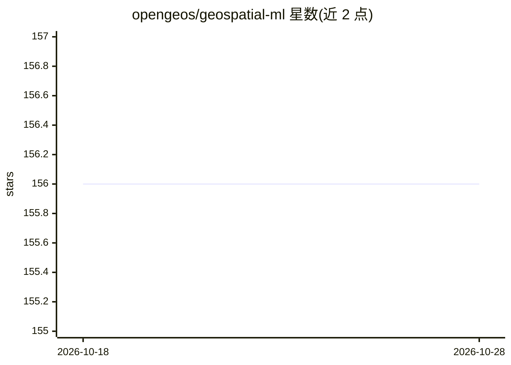

# opengeos/geospatial-ml

⭐ 156 · Python · MIT · 推送 2026-10-12 · [GitHub](https://github.com/opengeos/geospatial-ml) · [官网](https://ml.gishub.org) · 个人维护

**一条命令安装地理空间分析与机器学习常用包的 Python 元包**

opengeos 维护的 Python 元包，将地理空间分析与机器学习常用依赖打包为一条命令即可安装的形式，附 conda 版本分发，文档位于 ml.gishub.org。基于 Cookiecutter 与 giswqs/pypackage 模板创建，采用 MIT 许可。README 未列出所含具体包清单与使用示例，需查阅文档获取细节。

## 筛选速览

| 维度 | 判定 | 备注 |
|---|---|---|
| AI 角色 | `ai-ecosystem` | LLM/agent 周边工具 |
| 许可风险 | `permissive` | MIT |
| 部署形态 | `None` |  |
| 模型依赖 | — | README 未给出锁定关系 |
| 硬件要求 | — | 无带数字的原话,不猜 |
| 安装摩擦 | `low` | 无编译、无系统依赖或容器化 |
| 成熟度 | — | 结构信号不足 |

## 能力要点

- 一条命令安装地理空间分析与机器学习常用包
- 提供 conda 分发渠道
- MIT 许可并提供独立文档站点

## 适用场景

- 快速搭建地理空间机器学习的 Python 环境
- 教学或新项目中批量安装常用依赖

## 场景标签

 · 领域:GIS/机器学习工具链

## 证据(README 行号)

> L13: **A Python package for installing commonly used packages for geospatial analysis and machine learning with only one

## 星数曲线

2026-10-18 156 → 2026-10-28 156（+0）

---
*卡片 v1 · prompt 1.4 · 生成 2026-10-22 · 置信度 mid · 依据 README sha `5164fe622abe` · [字段定义](../../DATASET.md)*
