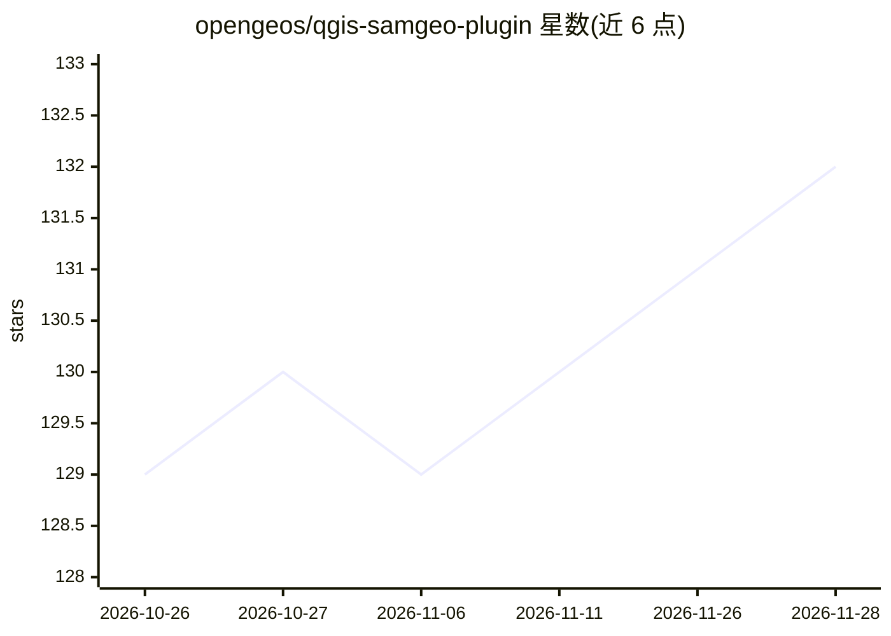

# opengeos/qgis-samgeo-plugin

⭐ 132 · Python · MIT · 推送 2026-11-27 · [GitHub](https://github.com/opengeos/qgis-samgeo-plugin) · [官网](https://samgeo.gishub.org) · 个人维护

**用 SAM 模型在 QGIS 内分割遥感影像的插件**

面向 QGIS 用户的遥感影像分割插件，封装 SamGeo Python 包，接入 Meta 的 Segment Anything 模型。支持 SAM1/SAM2/SAM3 三个版本，提供文本提示、点/框交互提示与批量点分割四种方式；输入支持带地理参考的 GeoTIFF，输出保存为矢量（GeoPackage/Shapefile）或栅格（GeoTIFF），矢量结果携带掩膜 ID、提示类型与置信分值等属性。安装需在 QGIS Python 环境中装 SamGeo（conda/pip），并配置 Hugging Face 认证与 SAM 3 模型访问授权；大图提供分块（tiled）文本分割以应对整景推理。

## 筛选速览

| 维度 | 判定 | 备注 |
|---|---|---|
| AI 角色 | `ai-native` | 本体是模型或模型工具 |
| 许可风险 | `permissive` | MIT |
| 部署形态 | `library` | 以包/库形式分发 |
| 模型依赖 | — | README 未给出锁定关系 |
| 硬件要求 | — | 无带数字的原话,不猜 |
| 安装摩擦 | `medium` | 含编译或系统依赖之一 |
| 成熟度 | — | 结构信号不足 |

## 能力要点

- 支持 SamGeo (SAM1)、SamGeo2 (SAM2)、SamGeo3 (SAM3) 三个模型版本
- 文本描述分割（如 building、tree、road）与点/框交互式分割
- 带地理参考影像支持，输出 GeoPackage/Shapefile/GeoTIFF 并保留空间参考
- 大 GeoTIFF 分块文本分割（默认 1024 px、重叠 128 px）

## 适用场景

- 在 QGIS 中对遥感影像按文字描述批量提取建筑、树木、道路等地物
- 在地图上点击圈画交互式分割感兴趣区域
- 对大场景 GeoTIFF 做分块分割并导出矢量掩膜

## 场景标签

`目标检测` · 领域:感知与多模态

## 证据(README 行号)

> L7: A QGIS plugin for remote sensing image segmentation using SamGeo, powered by Meta's Segment Anything Model (SAM).
> L11: - **Multiple SAM versions**: Support for SamGeo (SAM1), SamGeo2 (SAM2), and SamGeo3 (SAM3)
> L12: - **Text-based segmentation**: Describe what you want to segment (e.g., "building", "tree", "road")

## 星数曲线

2026-10-26 129 → 2026-11-28 132（+3）

---
*卡片 v1 · prompt 1.4 · 生成 2026-11-28 · 置信度 high · 依据 README sha `363c1a54f62a` · [字段定义](../../DATASET.md)*
