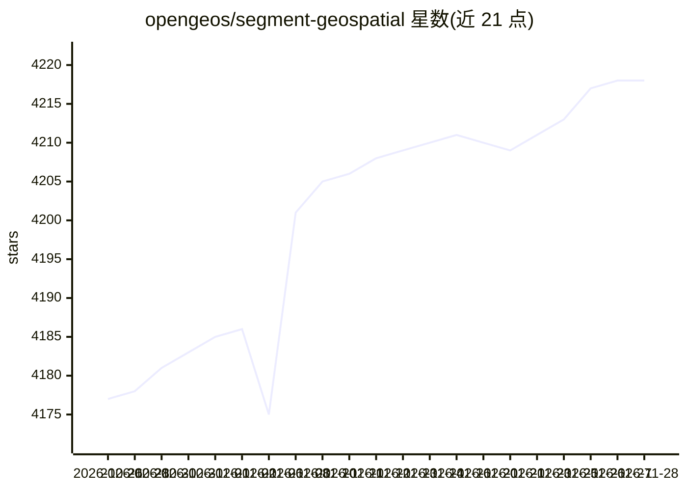

# opengeos/segment-geospatial

⭐ 4,218 · Python · MIT · 推送 2026-11-27 · [GitHub](https://github.com/opengeos/segment-geospatial) · [官网](https://samgeo.gishub.org) · 个人维护

**用 SAM 对地理空间遥感数据做分割的 Python 包**

SamGeo 是一个 Python 包，目标是让用户以少量代码调用 Segment Anything Model（SAM）分析地理空间数据。功能包括从 TMS 服务器下载地图瓦片生成 GeoTIFF、用 SAM/HQ-SAM/SAM 2/SAM 3 分割 GeoTIFF、文本提示分割、交互式标记、结果导出为 GeoPackage/Shapefile/GeoJSON 等矢量格式，并提供 REST API 服务。支持 pixi、PyPI、conda-forge 多种安装方式，另有 QGIS 插件；官方建议使用至少 8 GB 显存的 GPU 处理大数据集。

## 筛选速览

| 维度 | 判定 | 备注 |
|---|---|---|
| AI 角色 | `ai-native` | 本体是模型或模型工具 |
| 许可风险 | `permissive` | MIT |
| 部署形态 | `self-host` | docker 或自建部署 |
| 模型依赖 | — | README 未给出锁定关系 |
| 硬件要求 | — | 无带数字的原话,不猜 |
| 安装摩擦 | `low` | 无编译、无系统依赖或容器化 |
| 成熟度 | — | 结构信号不足 |

## 能力要点

- 支持 SAM、SAM 2、SAM 3、HQ-SAM 与文本提示分割
- 分割结果可导出 GeoPackage/Shapefile/GeoJSON 矢量格式
- 提供 REST API（FastAPI/Uvicorn）以 HTTP 方式提供分割服务
- 提供 QGIS 插件与 ArcGIS Pro 配合使用

## 适用场景

- 对卫星/遥感影像自动生成对象掩膜
- 用文本提示批量分割遥感影像中的目标（如泳池）
- 将分割结果保存为矢量格式用于 GIS 分析
- 在 QGIS 或 ArcGIS 中调用 SAM 分割功能

## 场景标签

`目标检测` · 领域:感知与多模态

## 证据(README 行号)

> L16: **A Python package for segmenting geospatial data with the Segment Anything Model (SAM)**
> L33: - Segment GeoTIFF files using the Segment Anything Model (SAM) and HQ-SAM
> L175: The Segment Anything Model is computationally intensive, and a powerful GPU is recommended to process large datase

## 星数曲线

2026-10-26 4,177 → 2026-11-28 4,218（+41）

---
*卡片 v1 · prompt 1.4 · 生成 2026-11-28 · 置信度 mid · 依据 README sha `571dc1abd43b` · [字段定义](../../DATASET.md)*
