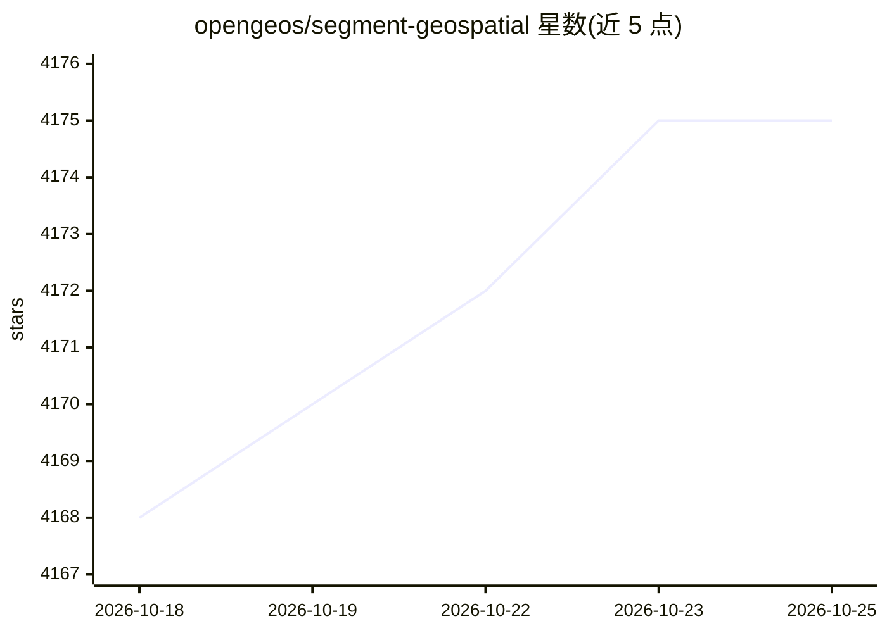

# opengeos/segment-geospatial

⭐ 4,175 · Python · MIT · 推送 2026-10-19 · [GitHub](https://github.com/opengeos/segment-geospatial) · [官网](https://samgeo.gishub.org) · 个人维护

**用 SAM 系列模型对遥感影像做地理空间分割的 Python 库**

SamGeo（segment-geospatial）是基于 Segment Anything Model 的地理空间分割 Python 包，源码改编自 segment-anything-eo。功能包括：从 TMS 服务器下载地图切片生成 GeoTIFF、用 SAM/HQ-SAM/Fast SAM/SAM 2/3 分割 GeoTIFF、文本提示分割（Grounding DINO）、前景背景交互标记、结果导出为 GeoPackage/Shapefile/GeoJSON、时序影像分割及 REST API 服务。提供 QGIS 插件，支持 pixi/PyPI（多 extras）/conda-forge 安装。建议使用至少 8GB 显存的 GPU，Windows 安装 SAM 3 需手动配置 CUDA 版 PyTorch。

## 筛选速览

| 维度 | 判定 | 备注 |
|---|---|---|
| AI 角色 | `ai-native` | 本体是模型或模型工具 |
| 许可风险 | `permissive` | MIT |
| 部署形态 | `self-host` | docker 或自建部署 |
| 模型依赖 | — | README 未给出锁定关系 |
| 硬件要求 | — | 无带数字的原话,不猜 |
| 安装摩擦 | `low` | 无编译、无系统依赖或容器化 |
| 成熟度 | — | 结构信号不足 |

## 能力要点

- SAM/HQ-SAM/Fast SAM/SAM 2/SAM 3 多模型分割 GeoTIFF
- 结合 Grounding DINO 的文本提示分割
- 结果导出为 GeoPackage/Shapefile/GeoJSON 并在交互地图可视化
- REST API 以 HTTP 提供分割服务，另有 QGIS 插件

## 适用场景

- 对遥感影像按文本或点/框提示提取地物矢量
- 批量生成卫星影像的自动掩膜
- 在 QGIS 或 ArcGIS 中叠加 SAM 分割结果
- 以 REST API 形式对外提供分割服务

## 场景标签

`目标检测` · 领域:感知与多模态

## 证据(README 行号)

> L16: **A Python package for segmenting geospatial data with the Segment Anything Model (SAM)**
> L33: - Segment GeoTIFF files using the Segment Anything Model (SAM) and HQ-SAM

## 星数曲线

2026-10-18 4,168 → 2026-10-25 4,175（+7）

---
*卡片 v1 · prompt 1.4 · 生成 2026-10-20 · 置信度 mid · 依据 README sha `6483b76cd989` · [字段定义](../../DATASET.md)*
