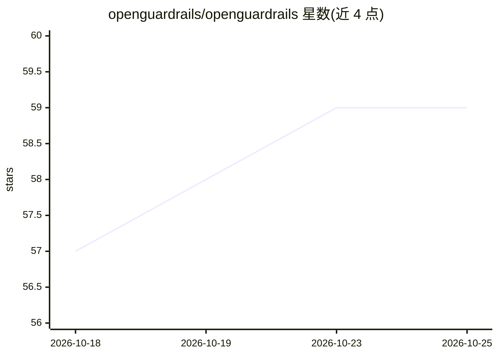

# openguardrails/openguardrails

⭐ 59 · Go · Apache-2.0 · 推送 2026-10-19 · [GitHub](https://github.com/openguardrails/openguardrails) · [官网](https://openguardrails.com) · 组织维护

**面向 AI agent 安全的厂商中立协议规范与检测器基准**

OpenGuardrails (OGR) 是一个 Apache-2.0 协议规范 monorepo，定义 agent 流量的分层模型（L1 Exec 到 L6 Session，对应网络分层）、GuardEvent 线上单元与 Verdict 决策契约，供安全/护栏检测厂商在其后接入竞争。它自称不做检测产品，只定义线协议并运营对合规检测器的中立基准与排行榜。集成方式为单一 HTTP 端点（POST /v1/evaluate）、每次模型调用两次转发，默认 fail-open；仓库含规范、JSON Schema、网关/agent 插件集成、基准与可运行示例。v0.7 起退役 SDK，API 即集成面。

## 筛选速览

| 维度 | 判定 | 备注 |
|---|---|---|
| AI 角色 | `ai-ecosystem` | LLM/agent 周边工具 |
| 许可风险 | `permissive` | Apache-2.0 |
| 部署形态 | `library` | 以包/库形式分发 |
| 模型依赖 | — | README 未给出锁定关系 |
| 硬件要求 | — | 无带数字的原话,不猜 |
| 安装摩擦 | `low` | 无编译、无系统依赖或容器化 |
| 成熟度 | — | 结构信号不足 |

## 能力要点

- 定义 GuardEvent/Verdict 线协议与 L1-L6 分层模型
- 统一 Safety 与 Security 两域于同一契约，风险类别taxonomy可替换
- 中立检测器基准与排行榜，检测器按 JSON Schema 判定合规
- 单一端点集成（每次模型调用两次转发），默认 fail-open

## 适用场景

- 为多个 agent 与 LLM 统一接入安全/护栏检测，避免 N×M×L 逐对集成
- 检测器厂商按 OGR 契约接入并参与基准排行
- 在网关或 agent harness 处执行 prompt injection、数据外泄等安全判定

## 场景标签

`网络安全` · 领域:学习与行业

## 证据(README 行号)

> L9: This monorepo is the home of the **OpenGuardrails (OGR) specification and its
> L14: OGR is **not a guardrail product**: it defines the wire and referees the
> L151: |**API**|The wire contract a runtime (PDP) exposes: `POST /v1/evaluate` (decide + record), heartbeat, health — car

## 星数曲线

2026-10-18 57 → 2026-10-25 59（+2）

---
*卡片 v1 · prompt 1.4 · 生成 2026-10-24 · 置信度 mid · 依据 README sha `e211fc735931` · [字段定义](../../DATASET.md)*
